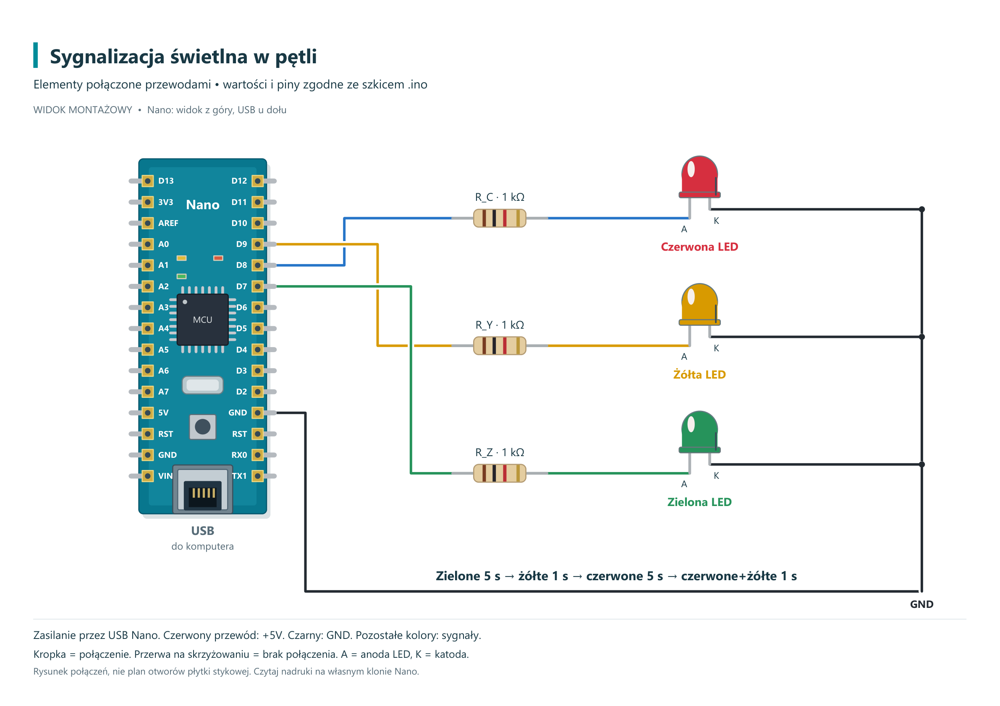

# Arduino — projekty

**Platforma:** klasyczne Nano / zgodny klon z logiką 5 V oraz Arduino Uno R3 w projektach FORBOT: stacji mikroklimatu, sekwencerze i laboratorium wahadła. Ich kody sprawdzono dla Uno i klasycznego Nano z ATmega328P. Projekty wykonuje się kolejno, wykorzystując ponownie te same części. Trzy projekty FORBOT wykorzystują elementy zestawów Arduino I i II oraz zawierają karty pracy ucznia; wahadło wymaga dodatkowo prostych materiałów mechanicznych.

## Wybierz projekt

| Projekt | Co zbudujesz i poznasz | Materiały |
|---|---|---|
| **Alarm odległości** | HC-SR04 mierzy odległość. Przy wyniku **poniżej 10 cm** czerwona LED miga, a brzęczyk nadaje przerywany alarm. Pomiar czasu echa i warunki w programie. | [Opis i schematy](projekty/alarm_odleglosci/README.md) · [Kod](projekty/alarm_odleglosci/alarm_odleglosci.ino) |
| **Lampka nocna** | LED płynnie rozjaśnia się po zasłonięciu fotorezystora. Potencjometr reguluje próg. Dzielnik napięcia, wejścia analogowe, PWM i histereza. | [Opis i schemat](projekty/lampka_nocna/README.md) · [Kod](projekty/lampka_nocna/lampka_nocna.ino) |
| **Refleksomierz** | Poczekaj na zielone światło i naciśnij przycisk. Program mierzy czas reakcji w milisekundach oraz wykrywa falstart. Przyciski, losowe oczekiwanie i odmierzanie czasu. | [Opis i schemat](projekty/refleksomierz/README.md) · [Kod](projekty/refleksomierz/refleksomierz.ino) |
| **Zamek szyfrowy** | Cztery przyciski i kod **1 → 3 → 2 → 4**. Zielona LED sygnalizuje otwarcie, czerwona zamknięcie. Tablice, sekwencje i obsługa błędów. | [Opis i schemat](projekty/zamek_szyfrowy/README.md) · [Kod](projekty/zamek_szyfrowy/zamek_szyfrowy.ino) |
| **Nadajnik Morse’a** | Jeden przycisk uruchamia SOS, drugi służy jako ręczny klucz. LED i brzęczyk nadają ten sam rytm. Kodowanie informacji i automat stanów. | [Opis i schematy](projekty/nadajnik_morsea/README.md) · [Kod](projekty/nadajnik_morsea/nadajnik_morsea.ino) |
| **Sygnalizacja świetlna** | Trzy LED przechodzą przez cztery fazy w pętli. Prosty kod: wyjścia cyfrowe, rezystory i opóźnienia `delay()`. | [Opis i schemat](projekty/sygnalizacja_swietlna/README.md) · [Kod](projekty/sygnalizacja_swietlna/sygnalizacja/sygnalizacja.ino) |
| **Wyświetlacz z ruchomym tekstem** | Dwa napisy przewijane w lewo na LCD 1602. Biblioteka LiquidCrystal, interfejs równoległy 4-bitowy, regulacja kontrastu i odmierzanie czasu przez `millis()`. | [Opis i schematy](projekty/baner_reklamowy_ruchomy/README.md) · [Kod](projekty/baner_reklamowy_ruchomy/baner_reklamowy_ruchomy.ino) |
| **Stacja mikroklimatu w klasie** | Temperatura i wilgotność z DHT11, drugi termometr DS18B20, LCD 16×2, przycisk MIN/MAX i alarm LED z histerezą. Porównanie czujników, dane CSV i odmierzanie czasu przez `millis()`. | [Opis i schematy](projekty/stacja_mikroklimatu/README.md) · [Kod](projekty/stacja_mikroklimatu/stacja_mikroklimatu.ino) · [Karta pracy](projekty/stacja_mikroklimatu/KARTA_PRACY.md) |
| **Mini studio muzyczne — sekwencer ośmiu kroków** | Klawiatura zapisuje do ośmiu nut lub pauz, piezo odtwarza pętlę, pokrętło ustawia tempo, a WS2812 wskazuje krok. Tablice, częstotliwości i rytm. | [Opis i schematy](projekty/sekwencer_muzyczny/README.md) · [Kod](projekty/sekwencer_muzyczny/sekwencer_muzyczny.ino) · [Karta pracy](projekty/sekwencer_muzyczny/KARTA_PRACY.md) |
| **Laboratorium wahadła — automatyczny pomiar okresu** | Kontaktron i magnes rejestrują ruch wahadła. LCD pokazuje średni okres z dziesięciu cykli oraz oszacowanie g. Pomiar czasu, uśrednianie i analiza błędów. | [Opis i schematy](projekty/laboratorium_wahadla/README.md) · [Kod](projekty/laboratorium_wahadla/laboratorium_wahadla.ino) · [Karta pracy](projekty/laboratorium_wahadla/KARTA_PRACY.md) |

//////////////////////////////////
Przykład
//////////////////////////////////

### Cykl sygnalizacji świetlnej

🟢 **5 s** → 🟡 **2 s** → 🔴 **5 s** → 🔴🟡 **2 s** → ponownie 🟢

Pełny cykl trwa nominalnie **14 sekund**.

## Uruchomienie

1. Pobierz całe repozytorium przez **Code → Download ZIP** i rozpakuj je.
2. Wybierz projekt, przeczytaj jego README i przygotuj wymienione części.
3. Przy odłączonym USB zmontuj układ według schematu. W alarmie i nadajniku Morse’a wykonaj też osobny tor L293D i brzęczyka.
4. Otwórz plik `.ino` w Arduino IDE. W projektach z plikiem `Przycisk.h` pozostaw go obok szkicu, w tym samym folderze.
5. Wybierz płytkę zgodnie z instrukcją projektu: **Arduino Nano** dla pierwszych siedmiu schematów albo **Arduino Uno** dla trzech projektów FORBOT. W Nano dobierz procesor i bootloader do swojej płytki; w starszych klonach może być potrzebne **ATmega328P (Old Bootloader)**. Baner i wahadło wymagają **LiquidCrystal**. Stacja wymaga **LiquidCrystal, DHT sensor library, Adafruit Unified Sensor, OneWire i DallasTemperature**. Sekwencer wymaga **Keypad i Adafruit NeoPixel**. Instalację i sprawdzone wersje podano w instrukcjach projektów; pozostałe ćwiczenia nie wymagają dodatkowych bibliotek.
6. Podłącz USB, wgraj kod i wykonaj próby z instrukcji projektu. W projektach korzystających z Monitora portu szeregowego ustaw **9600 baud**.

## Płytka, zasilanie i schematy

- Zasilanie projektów: **USB płytki Arduino, 5 V**. Wszystkie elementy mają wspólną masę GND. Bateria 9 V ani zasilacz 12 V nie są potrzebne do tych ćwiczeń.
- Zestaw rozpoznano jako format klasycznego Nano. Przed wyborem procesora odczytaj oznaczenie mikrokontrolera na swoim klonie; sprawdzone kody przygotowano dla **ATmega328P 16 MHz**.
- Każda osobna LED sygnalizacyjna ma rezystor **1 kΩ**. Podświetlenie LCD wykorzystuje **330 Ω**, zgodnie z instrukcją wyświetlacza. Przyciski łączą wejścia z GND; podciąganie `INPUT_PULLUP` włącza program.
- Rysunki pokazują elementy i kolorowe przewody. Nano jest widoczne z góry, USB u dołu; w trzech projektach FORBOT pokazano Uno z USB u góry. Dobierz otwory breadboardu według jego rzeczywistych grup styków. Instrukcje wyjaśniają orientację czujników, rezystory podciągające, zwarte pary styków przycisku, identyfikację klawiatury i kierunek danych WS2812.
- Alarm i nadajnik Morse’a używają aktywnego brzęczyka oraz L293D. Wymagane napięcie konkretnego brzęczyka trzeba potwierdzić; sterownik powoduje spadek napięcia. Pełny opis i oba schematy są w instrukcjach tych projektów.

## Sprawdzenie kodu

Wszystkich dziesięć szkiców przeszło kompilację dla **ATmega328P 16 MHz**. W uproszczonej sygnalizacji sprawdzono kompilację i kolejność czterech faz; pozostałe dziewięć projektów przeszło również testy logiki z atrapami sprzętu. Wyświetlacz sprawdzono z biblioteką **LiquidCrystal 1.0.7**. Trzy projekty FORBOT skompilowano dla **Uno i klasycznego Nano** z rzeczywistymi bibliotekami. Stacja przeszła dziewięć grup testów, sekwencer dziewięć, a wahadło osiem; obejmują m.in. czasy, sterowanie, pamięć, obsługę błędów i zawinięcia zegara. Nie wykonano prób na fizycznym zestawie. Instrukcje projektów podają oczekiwane zachowanie i próby do wykonania po montażu.

Podstawą parametrów są [dokumentacja klasycznego Nano](https://docs.arduino.cc/hardware/nano/) i [oficjalny pinout](https://docs.arduino.cc/resources/pinouts/A000005-full-pinout.pdf). Źródła dotyczące czujnika, sterownika i pozostałych funkcji podano przy poszczególnych projektach.
