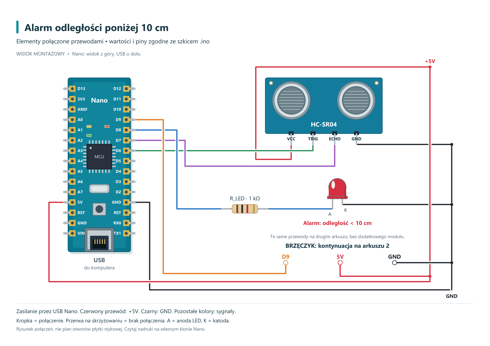
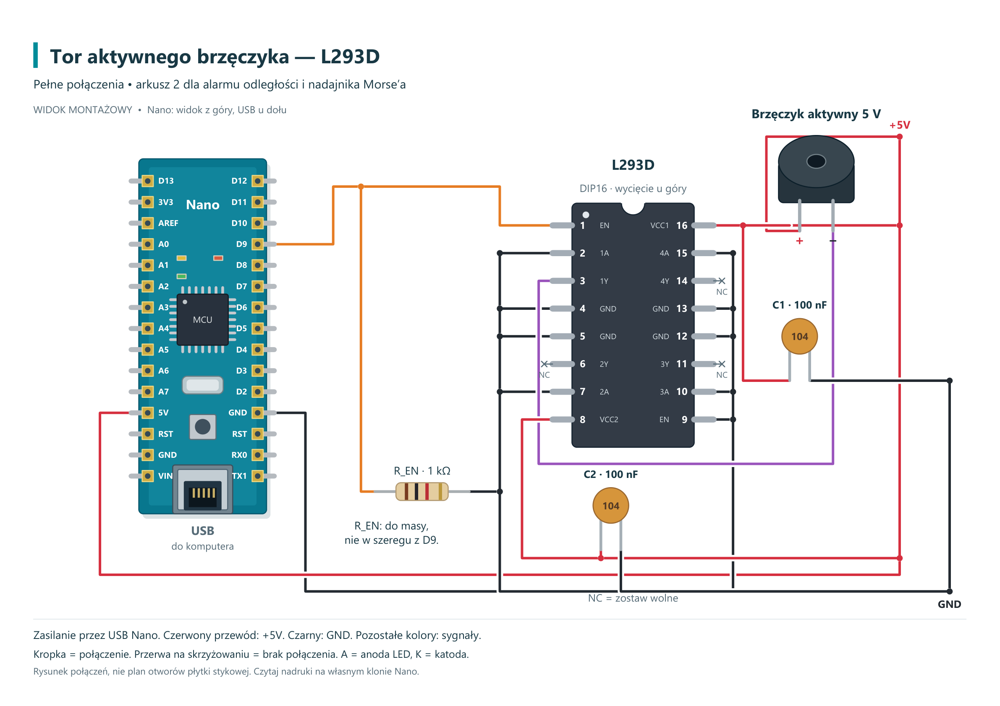

# Alarm odległości poniżej 10 cm

**Poziom:** średni · **Czas orientacyjny:** 60–90 min · **Płytka:** klasyczne Nano / zgodny klon z logiką 5 V.

Wykryj przeszkodę przed HC-SR04. Gdy poprawnie zmierzona odległość jest mniejsza niż 10 cm, czerwona LED i brzęczyk włączają się na 200 ms i wyłączają na 200 ms. Przy 10 cm lub większej odległości alarm milczy.

## Elementy z zestawu

- Nano zgodne z klasycznym formatem 5 V, przewód USB do danych, płytka stykowa i przewody
- HC-SR04 — 1 szt.
- czerwona LED — 1 szt.; rezystor 1 kΩ do LED — 1 szt.
- aktywny brzęczyk — 1 szt.; L293D — 1 szt.
- rezystor 1 kΩ R_EN — 1 szt.; kondensatory 100 nF — 2 szt.

Projekty wykonujesz kolejno, wykorzystując ponownie tę samą płytkę i części. Przewód USB oraz komputer to stanowisko do zasilania i wgrywania kodu.

## Schemat i połączenia

[Otwórz schemat w pełnej rozdzielczości](schemat_montazowy.png).

Nano pokazano z góry, z USB u dołu i kolejnością pinów klasycznego Nano. Połączenia wykonuj według oznaczeń na własnej płytce. To widok elementów i przewodów; grupy otworów płytki stykowej trzeba dobrać samodzielnie.

**Czerwony przewód: +5V. Czarny: GND. Pozostałe kolory: sygnały.** Kropka oznacza połączenie, a przerwa przy skrzyżowaniu — brak połączenia. A to anoda LED, K — katoda. Każda LED ma własny rezystor 1 kΩ.

| Od | Do | Uwagi |
|---|---|---|
| Nano 5V | HC-SR04 VCC | Zasilanie czujnika 5 V |
| Nano GND | HC-SR04 GND | Wspólna masa |
| Nano D6 | HC-SR04 TRIG | Wyzwalanie pomiaru |
| Nano D7 | HC-SR04 ECHO | Odczyt czasu echa, logika 5 V |
| Nano D8 | Rezystor 1 kΩ → anoda czerwonej LED | Rezystor szeregowo z LED |
| Katoda LED | Nano GND | Katoda: sprawdź oznaczenie LED |
| Nano D9 | L293D pin 1 (1,2EN) | Sterowanie EN_D9; HIGH = brzęczyk włączony |
| L293D pin 1 | Rezystor R_EN 1 kΩ → GND | Podciągnięcie EN do masy podczas resetu |
| Nano 5V | L293D piny 16 (VCC1) i 8 (VCC2) | Oba zasilania +5V |
| Nano GND | L293D piny 4, 5, 12, 13 | Wspólna masa |
| Nano GND | L293D piny 2 (1A), 7 (2A), 10 (3A), 15 (4A), 9 (3,4EN) | Stałe stany wejść |
| Nano 5V | Brzęczyk + | Zasilanie brzęczyka 5 V |
| Brzęczyk − | L293D pin 3 (1Y) | Net BUZ_MINUS; nie podłączaj tego końca bezpośrednio do GND |
| L293D pin 16 | C1 100 nF → GND | Blisko obudowy |
| L293D pin 8 | C2 100 nF → GND | Blisko obudowy |
| L293D piny 6, 11, 14 | Bez połączenia (NC) | To wyjścia; nie zwieraj do zasilania lub masy |

### Tor dźwięku — ważne przed montażem

Zmontuj również cały tor L293D z poniższego rysunku. Jest wymagany do działania dźwięku.

[Otwórz schemat toru brzęczyka w pełnej rozdzielczości](tor_brzeczyka_montazowy.png).

Brzęczyk ma być standardowym aktywnym modelem 5 V. Zdjęcie opakowania nie podaje jego napięcia i prądu: sprawdź nadruk lub dokumentację zestawu. Nie traktuj L293D jako ogranicznika napięcia. Układ ma spadek napięcia na wyjściu, więc brzęczyk dostaje mniej niż pełne 5 V i może grać ciszej. Jeżeli dany egzemplarz nie startuje, nie zastępuj toru połączeniem wprost z GPIO bez sprawdzenia prądu. To rzeczywista niepewność identyfikacji części ze zdjęcia.

W naszym połączeniu pin 2 L293D jest na GND. D9 steruje **EN, pin 1**: HIGH włącza wyjście 1Y w stan niski i prąd płynie przez brzęczyk; LOW odłącza wyjście do wysokiej impedancji. Rezystor R_EN 1 kΩ wycisza tor podczas resetu. Masa obu zasileń i Nano jest wspólna. Kondensatory 100 nF umieść blisko pinów 16 i 8. Wyjścia oznaczone NC zostaw wolne.

## Montaż i uruchomienie

Przepinaj elementy przy odłączonym USB. Obie nóżki LED muszą należeć do różnych węzłów; każda LED ma własny rezystor. Sprawdź, czy szyny płytki stykowej są ciągłe, i w razie potrzeby połącz ich segmenty.

1. Włóż HC-SR04 tak, aby każda z czterech nóżek należała do osobnego węzła. Czytaj nadruki VCC/TRIG/ECHO/GND na module.
2. Zbuduj obwód LED. Następnie wykonaj cały tor L293D z osobnego schematu toru brzęczyka. Sprawdź jego orientację i masy.
3. Wgraj szkic i otwórz Monitor portu szeregowego: 9600 baud. Ustaw płaską przeszkodę, np. zeszyt, w odległości 15–20 cm.
4. Przesuwaj zeszyt do około 5–9 cm. Obserwuj miganie i dźwięk, potem ponownie oddal przeszkodę.

Otwórz **alarm_odleglosci.ino** w Arduino IDE. Nie instalujesz dodatkowych bibliotek. Wybór płytki i portu opisano w [instrukcji uruchomienia](../../README.md#uruchomienie).

## Sprawdzenie na stanowisku

Poniższe testy należy wykonać na złożonym układzie. Oczekiwane wyniki nie oznaczają, że zestaw ze zdjęcia został fizycznie przetestowany.

| Próba | Oczekiwany wynik |
|---|---|
| 20 cm przed czujnikiem | LED czerwona i brzęczyk wyłączone; Serial pokazuje OK. |
| Około 5 cm przed czujnikiem | Czerwona LED i brzęczyk pracują wspólnie w rytmie ok. 200/200 ms. |
| Wartość pomiaru dokładnie 10,00 cm | Warunek kodu jest ścisły: alarm wyłączony. Przy granicy rzeczywiste odczyty mogą się wahać. |
| Brak echa / cel poza zakresem | Oddzielny komunikat w Serial i miganie diody wbudowanej; nie udajemy pomiaru 0 cm. |

## Co wyjaśnić uczniom

czas przelotu fali, funkcja pulseIn(), warunek <, millis(), buforowanie wyjścia L293D.

HC-SR04 ma nominalną strefę pomiaru od około 2 cm do 4 m. Poniżej 2 cm nie można obiecać wykrycia, dlatego ćwiczenie wykonuj w przedziale 3–30 cm. Brak echa nie dowodzi braku przeszkody. Wynik echoUs / 58 jest przybliżeniem zależnym od warunków; to demonstrator, nie układ zabezpieczający. Pomiary startują nie częściej niż co 70 ms. Timeout 25 ms chroni program przed oczekiwaniem bez końca.

## Zadania dodatkowe

- Zmień ALARM_CM na 15 i sprawdź zachowanie.
- Zmień BLINK_INTERVAL_MS; opisz różnicę między okresem migania i czasem jednej fazy.

## Gdy coś nie działa

- Sprawdź zgodność modelu i logiki 5 V oraz wybraną płytkę i port w IDE.
- Sprawdź wspólną masę i rzeczywiste grupy po pięć otworów w breadboardzie.
- Sprawdź polaryzację LED, wartość rezystora i zgodność numeru pinu z kodem.

## Weryfikacja i źródła

Kod sprawdzono przez kompilację dla ATmega328P 16 MHz z Arduino AVR Boards 1.8.8 oraz testy logiki z symulowanymi wejściami. Nie wykonano prób na fizycznym zestawie. Testy stanowiskowe powyżej wykonaj po złożeniu układu.

[HC-SR04 — dokumentacja](https://cdn.sparkfun.com/datasheets/Sensors/Proximity/HCSR04.pdf) · [L293D — dokumentacja TI](https://www.ti.com/lit/ds/symlink/l293d.pdf)

[← Wszystkie projekty](../../README.md)
