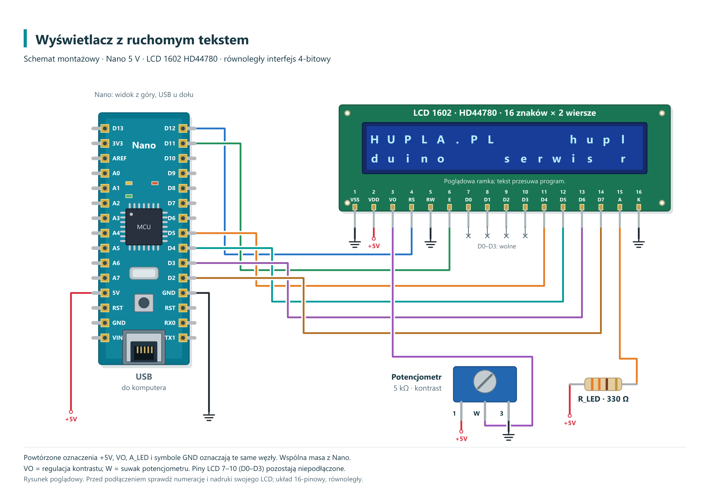

# Wyświetlacz z ruchomym tekstem

**Poziom:** podstawowy/średni · **Płytka:** klasyczne Nano / zgodny klon, ATmega328P, 5 V.

Zbuduj baner na wyświetlaczu **LCD 1602 — 16 znaków w dwóch wierszach**. Oba napisy przesuwają się w lewo o jedną kolumnę, nominalnie co 500 ms. Kolejne kopie tekstu rozdzielają trzy spacje. Program powtarza przewijanie w pętli.

[Otwórz kod Arduino](baner_reklamowy_ruchomy.ino). Zachowano oryginalny szkic użytkownika bez zmian. Schemat dotyczy **LCD 5 V zgodnego z HD44780, z równoległym złączem 16-pinowym**. Moduł mający tylko `GND`, `VCC`, `SDA`, `SCL` korzysta z I²C i wymaga innego podłączenia oraz kodu.

## Potrzebne elementy

| Element | Ilość | Uwagi |
|---|---:|---|
| Nano / zgodny klon, ATmega328P, 5 V | 1 | Zasilanie i programowanie przez USB. |
| LCD 1602, HD44780 lub zgodny, równoległy, 16 pinów, 5 V | 1 | Sprawdź oznaczenia i numerację na swoim module. |
| Potencjometr 5 kΩ | 1 | Regulacja kontrastu; można wykorzystać element z zestawu. |
| Rezystor 330 Ω | 1 | Szeregowo z podświetleniem LCD. |
| Płytka stykowa i przewody połączeniowe | 1 komplet | Wspólne szyny 5 V i GND. |
| Kabel USB i komputer z Arduino IDE | 1 komplet | Kabel pasujący do gniazda Twojego Nano. |

Jeśli LCD ma same otwory lutownicze, potrzebna jest zamontowana listwa **1×16, raster 2,54 mm**. Samo wsunięcie luźnych przewodów w otwory nie zapewnia pewnego kontaktu.

## Schemat i połączenia



[Otwórz schemat montażowy](schemat_montazowy.png) · [Otwórz arkusz połączeń elektrycznych](schemat_elektryczny.png)

Nano jest pokazane z góry, z USB u dołu. Rysunek przedstawia połączenia elementów; otwory płytki stykowej dobierz według jej rzeczywistych grup styków. Przepinaj przewody przy odłączonym USB. Zasilanie logiki LCD i Nano w tym wariancie wynosi **5 V**.

| Pin LCD | Oznaczenie LCD | Połącz z |
|---:|---|---|
| 1 | VSS | GND Nano |
| 2 | VDD / VCC | 5 V Nano |
| 3 | VO | Suwak potencjometru 5 kΩ |
| 4 | RS | Nano D12 |
| 5 | R/W | GND |
| 6 | E | Nano D11 |
| 7–10 | D0–D3 | Pozostaw wolne — używany jest tryb 4-bitowy |
| 11 | D4 | Nano D5 |
| 12 | D5 | Nano D4 |
| 13 | D6 | Nano D3 |
| 14 | D7 | Nano D2 |
| 15 | A / LED+ | 5 V przez rezystor 330 Ω |
| 16 | K / LED− | GND |

Skrajne wyprowadzenia potencjometru podłącz do **5 V i GND**, a suwak do **VO**. Sprawdź wyprowadzenia swojego potencjometru. Wszystkie punkty GND są ze sobą połączone. Oznaczenia D4–D7 na LCD i D2–D5 na Nano dotyczą dwóch różnych elementów — kieruj się tabelą.

Rezystor 330 Ω ogranicza prąd podświetlenia. Niektóre moduły zawierają już własny rezystor; dodatkowy może wtedy zmniejszyć jasność. Porównaj oznaczenia i specyfikację swojego LCD z pokazanym wariantem. Potencjometr służy do kontrastu, a nie do regulacji prądu podświetlenia.

## Uruchomienie w Arduino IDE

1. Przy odłączonym USB zmontuj układ i sprawdź numerację LCD, połączenie R/W z GND oraz wspólną masę.
2. W Menedżerze bibliotek zainstaluj oficjalną **LiquidCrystal**, autorzy **Arduino, Adafruit**, jeśli nie jest dostępna w IDE. Ten projekt sprawdzono z wersją **1.0.7**.
3. Otwórz [baner_reklamowy_ruchomy.ino](baner_reklamowy_ruchomy.ino), pozostawiając go w folderze `baner_reklamowy_ruchomy`.
4. Wybierz **Arduino Nano**, właściwy port i procesor/bootloader zgodny z płytką. Szczegóły opisano w [głównej instrukcji repozytorium](https://github.com/frogmaker/Arduino#uruchomienie).
5. Podłącz USB, wgraj szkic i powoli wyreguluj potencjometr, aż znaki będą czytelne.

Przykładowa zawartość obu wierszy zaraz po starcie:

```text
HUPLA.PL    hupl
duino   serwis r
```

Dolny wiersz ma początkowe przesunięcie `pozycjaDolna = 8`. Ponieważ tekst jest powtarzany, z lewej może być widoczna końcówka poprzedniej kopii — nie oznacza to błędu.

## Zmiana tekstu i tempa

W aktywnej części szkicu edytuj:

```cpp
const char napis1[] = "HUPLA.PL    hupla.pl";
const char napis2[] = "serwis retro druk3D arduino";
const int ODSTEP = 3;
const unsigned long SPEED = 500;
```

`napis1` to górny wiersz, a `napis2` dolny. `ODSTEP` ustala odstęp między kopiami tekstu; `SPEED` jest minimalnym odstępem kolejnych przesunięć w milisekundach. Mniejsza wartość przyspiesza przewijanie. Oryginalny plik zawiera także wcześniejsze, zakomentowane przykłady — zmieniaj definicje używane przez aktywny program.

Najprościej korzystać ze znaków ASCII. Polskie litery UTF-8 wymagają dodatkowej obsługi znaków LCD, której ten szkic nie zawiera. Przy bardzo krótkich napisach może być potrzebne zwiększenie liczby powtórzeń rysowanych w `pokazNapis()`; bieżące teksty mają 20 i 27 znaków i zostały sprawdzone w pełnym cyklu.

## Co wyjaśnić uczniom

Biblioteka `LiquidCrystal` obsługuje wyświetlacz przez sześć sygnałów wskazanych w `LiquidCrystal lcd(12, 11, 5, 4, 3, 2)`. Przewijaniem zarządza `millis()`. Funkcja `pokazNapis()` wylicza pozycje kolejnych kopii tekstu i zapisuje tylko znaki mieszczące się w 16 kolumnach. To ruch o całe pozycje znaków, a nie animacja pikselowa.

## Sprawdzenie i rozwiązywanie problemów

| Próba / objaw | Oczekiwany wynik lub czynność |
|---|---|
| Uruchomienie | Na obu wierszach pojawiają się fragmenty napisów. |
| Obserwacja przez kilka sekund | Oba teksty przesuwają się w lewo, co około pół sekundy. |
| Kolejne powtórzenia | Teksty wracają z odstępem trzech spacji. |
| Świeci tylko podświetlenie albo widać prostokąty | Wyreguluj kontrast, potem sprawdź R/W, RS, E i linie D4–D7 według tabeli. |
| Brak podświetlenia | Sprawdź polaryzację A/K, rezystor i wymagania modułu; sprawdź również, czy tekst jest widoczny przy oświetleniu zewnętrznym. |
| Nieprawidłowe znaki | Sprawdź przewody danych, kontakt listwy oraz treść wpisaną w programie. |

Przed narysowaniem kolejnej klatki program zapisuje spacje w obu wierszach. Może to powodować krótkie widoczne mrugnięcie. Po długim zatrzymaniu pętli wykonuje jedno przesunięcie, bez nadrabiania wszystkich pominiętych klatek.

Oryginalny szkic przeszedł kompilację i linkowanie dla **Nano / ATmega328P, 16 MHz** z **Arduino AVR Boards 1.8.8** i **LiquidCrystal 1.0.7**, bez ostrzeżeń szkicu. Osiem testów programowych sprawdziło m.in. zawartość 16×2, pełny cykl powtórzeń, odstęp 500 ms i zawinięcie `millis()`. Nie przeprowadzono próby na fizycznym LCD.

## Źródła

- [Oficjalna biblioteka Arduino LiquidCrystal](https://github.com/arduino-libraries/LiquidCrystal).
- [Przykład HelloWorld z identycznym przypisaniem sześciu pinów](https://github.com/arduino-libraries/LiquidCrystal/blob/master/examples/HelloWorld/HelloWorld.ino).
- [Przykładowa karta modułu LCD 16×2 — numeracja złącza](https://newhavendisplay.com/content/specs/NHD-0216K1Z-NSW-FBW-L.pdf). Jest to punkt odniesienia dla standardu złącza, nie identyfikacja konkretnego LCD użytkownika.

[← Wszystkie projekty Arduino](https://github.com/frogmaker/Arduino#wybierz-projekt)
