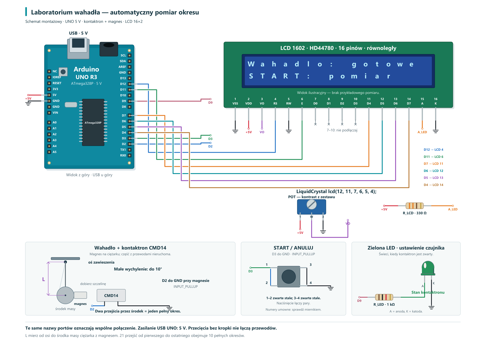

# Laboratorium wahadła — automatyczny pomiar okresu

**Poziom:** średni · **Płytka:** Arduino Uno R3 / klasyczne Nano ATmega328P, 5 V · **Części elektroniczne:** FORBOT Arduino I i II.

Zbuduj wahadło z magnesem na ciężarku. Nieruchomy kontaktron rejestruje jego przejścia, a Arduino mierzy **dziesięć pełnych okresów**, pokazuje średni okres na LCD i oblicza orientacyjne przyspieszenie ziemskie. Długość i czas pochodzą z doświadczenia; program nie podstawia gotowej wartości g.

[Kod Arduino](laboratorium_wahadla.ino) · [Karta pracy](KARTA_PRACY.md) · [Schemat montażowy](schemat_montazowy.png) · [Schemat elektryczny](schemat_elektryczny.png)

## Potrzebne elementy

| Element | Ilość | Zastosowanie / zestaw |
|---|---:|---|
| Arduino Uno R3 lub klasyczne Nano, ATmega328P 5 V | 1 | Płytka z poziomu I. |
| Kontaktron CMD14 z elementem magnetycznym | 1 komplet | Poziom II; przewodowa część nieruchoma, magnes na ciężarku. |
| LCD 1602, HD44780 lub zgodny, 5 V, równoległy, 16 pinów | 1 | Poziom I; wersja ze złączami. |
| Potencjometr montażowy z zestawu | 1 | Kontrast LCD; opis zestawu nie określa wartości. |
| Przycisk tact-switch | 1 | START / ANULUJ. |
| Zielona LED i rezystor 1 kΩ | Po 1 | Wskazanie zwarcia kontaktronu. |
| Rezystor 330 Ω | 1 | Podświetlenie LCD. |
| Płytka stykowa, przewody i kabel USB | 1 komplet | Zestawy I i II. |
| Komputer z Arduino IDE | 1 | Programowanie, ustawienie długości i opcjonalny Monitor. |

Dodatkowe materiały mechaniczne: **sznurek, niewielki ciężarek, stabilny punkt zawieszenia, mocowanie czujnika i magnesu oraz linijka lub miarka**; do ustawienia kąta przyda się kątomierz. Nie są one deklarowaną zawartością zestawów elektronicznych.

Skład zestawów: [poziom I](https://botland.com.pl/zestawy-i-kursy-forbot/12642-zestaw-forbot-do-kursu-arduino-min-z-mikrokontrolerem-plytka-stykowa-materialy-edukacyjne-5903351242899.html) i [poziom II](https://botland.com.pl/zestawy-i-kursy-forbot/11819-forbot-arduino-poziom-2-zestaw-elementow-kurs-on-line-5903351242868.html). [CMD14](https://botland.com.pl/czujniki-magnetyczne/3104-czujnik-magnetyczny-otwarcia-drzwi-okien-kontaktron-cmd14-srubki-5904422366247.html) zawiera czujnik z przewodami i osobny magnes; styki zwierają się po zbliżeniu obu części.

## Schematy i połączenia



[Powiększ schemat montażowy](schemat_montazowy.png) · [Schemat elektryczny](schemat_elektryczny.png)

Zasilanie całego układu: **USB Arduino, 5 V**, wspólna masa GND. Zasilacz 12 V i bateria 9 V nie są potrzebne. Powtarzające się nazwy węzłów oznaczają połączenie; przecięcia bez kropek go nie tworzą. Dobierz otwory breadboardu według jego rzeczywistych grup styków.

### LCD i potencjometr

W tym projekcie przypisanie danych LCD różni się od banera i stacji mikroklimatu: `LiquidCrystal lcd(12, 11, 7, 6, 5, 4);`. D2 pozostaje dla kontaktronu, a D3 dla przycisku.

| Pin LCD | Funkcja | Połączenie |
|---:|---|---|
| 1 | VSS | GND |
| 2 | VDD / VCC | 5 V |
| 3 | VO | Suwak potencjometru kontrastu |
| 4 | RS | Arduino D12 |
| 5 | R/W | GND |
| 6 | E | Arduino D11 |
| 7–10 | D0–D3 | Wolne |
| 11 | D4 | Arduino D7 |
| 12 | D5 | Arduino D6 |
| 13 | D6 | Arduino D5 |
| 14 | D7 | Arduino D4 |
| 15 | A / LED+ | 5 V przez 330 Ω |
| 16 | K / LED− | GND |

Końce potencjometru połącz z 5 V i GND, suwak z VO. Sprawdź jego wyprowadzenia. Dodatkowy rezystor podświetlenia może zmniejszyć jasność modułu mającego już własny rezystor. LCD z samymi pinami `GND/VCC/SDA/SCL` wymaga innego kodu i schematu.

### Kontaktron, przycisk i LED

| Element | Połączenie |
|---|---|
| Przewodowa część CMD14 | Jeden przewód D2, drugi GND; kolejność tych dwóch przewodów nie ma znaczenia. |
| Przycisk START / ANULUJ | D3 i GND przez styk zwierany po naciśnięciu. |
| Zielona LED | D9 → 1 kΩ → anoda; katoda do GND. |

Program włącza `INPUT_PULLUP` na D2 i D3. Otwarty kontaktron daje HIGH, zwarty LOW. LED świeci po rozpoznaniu stabilnego zwarcia i pomaga ustawić położenie magnesu.

W czteronóżkowym przycisku dwie pary styków są zwarte na stałe. **D3 i GND podłącz do różnych par**, które łączą się dopiero po naciśnięciu. Numery nóżek przycisku na schemacie są umowne; sprawdź pary miernikiem. Dla Nano zachowaj oznaczenia pinów z tabel, dobierając ich położenie według pinoutu Nano.

## Przygotowanie wahadła

1. Zawieś niewielki ciężarek na sznurku. Magnes przymocuj do niego tak, aby poruszał się wraz z całym ciężarkiem.
2. Nieruchomy czujnik z przewodami ustaw obok toru magnesu, blisko dolnego położenia. Czujnik i wahadło nie powinny się zderzać. Przewody nie poruszają się razem z ciężarkiem.
3. Zmierz **L od punktu zawieszenia do środka masy całego ciężarka wraz z magnesem**. Długość samego sznurka może być inna.
4. Przed pełnym pomiarem powoli przesuwaj magnes po torze. LED powinna pokazać **jedno wyraźne zwarcie na każde przejście**. Wyreguluj odstęp i orientację obu części.
5. Wykonuj doświadczenie przy małym wychyleniu, np. około 5°, do 10°. Puść ciężarek bez dodatkowego popychania.

Mechanika na rysunku jest schematyczna. Jej proporcje i ustawienie czujnika trzeba dobrać do rzeczywistego wahadła. Program oczekuje zwarcia trwającego co najmniej około 10 ms oraz odstępu przynajmniej 100 ms między zaakceptowanymi zwarciami.

## Uruchomienie w Arduino IDE

1. Odłącz USB, zmontuj elektronikę i sprawdź połączenia LCD, przycisku oraz kontaktronu.
2. Zainstaluj bibliotekę **LiquidCrystal**, autorzy Arduino, Adafruit. Sprawdzona wersja: **1.0.7**.
3. Otwórz [laboratorium_wahadla.ino](laboratorium_wahadla.ino) w folderze `laboratorium_wahadla`.
4. Zmień `const float DLUGOSC_M = 0.50f;` na swoją zmierzoną długość w metrach, z kropką dziesiętną. Zakres przewidziany w programie: **0,10–2,00 m**. Każda zmiana długości wymaga wpisania nowej wartości i ponownego wgrania.
5. Wybierz Uno lub klasyczne Nano ATmega328P z odpowiednim bootloaderem, właściwy port i wgraj kod.
6. Wyreguluj kontrast LCD. Na ekranie spoczynkowym sprawdź wpisaną długość. Monitor portu szeregowego ustaw na **9600 baud**.
7. Rozbujaj wahadło małym wychyleniem i naciśnij START. Po zebraniu 21 przejść zobaczysz średni okres i oszacowane g. Kolejne naciśnięcie po wyniku rozpoczyna nową próbę; w czasie oczekiwania lub pomiaru anuluje bieżącą.

Jeśli kontaktron jest zwarty w chwili START, program poczeka na jego rozwarcie, a następnie na nowe zwarcie. Przytrzymanie przycisku nie uruchamia kolejnych prób.

## Co jest mierzone

Wahadło przechodzi obok czujnika dwa razy w pełnym cyklu. Czas od przejścia **1 do 3** to jeden okres; od **3 do 5** kolejny. Czas od **1 do 21** obejmuje dziesięć okresów:

```text
T_średni = (czas_przejścia_21 − czas_przejścia_1) / 10
g = 4 × π² × L / T_średni²
```

L podajemy w metrach, T w sekundach, g otrzymujemy w m/s². Wzór opisuje przybliżenie wahadła prostego przy małych wychyleniach. W ćwiczeniu należy zbadać, jak na wynik wpływają pomiar długości, amplituda, ustawienie czujnika i opory ruchu. Zależność okresu od długości oraz metoda liczenia pełnych okresów są opisane w [instrukcji laboratorium Arizona State University](https://www.webassign.net/question_assets/asucolphysmechl2/lab_9/manual.pdf); nasz wariant wykrywa przejścia magnetycznie.

Program filtruje drgania styków przez 10 ms, przycisk przez 30 ms. Znacznik `micros()` pochodzi z pierwszego zauważenia zbocza, które potem utrzymało się przez wymagany czas. Nie jest to sprzętowy zapis idealnego momentu przejścia: pętla, Serial, LCD i mechanika wnoszą opóźnienia. Trzy miejsca po przecinku na LCD nie oznaczają dokładności do 1 ms.

Brakujące lub podwójne impulsy mogą dać błędny okres mimo ukończenia próby. Przed pomiarem obserwuj LED i porównaj liczbę przejść z ruchem. Najpierw oceniaj powtarzalność i niepewność, a dopiero potem zgodność g z wartością odniesienia.

## Ekrany, Serial i limity

| Stan | Zachowanie |
|---|---|
| Gotowy | LCD pokazuje L oraz wskazówkę START. |
| Oczekiwanie | Czeka na pierwsze nowe przejście. |
| Pomiar | `P` to liczba przejść z 21, `N` liczba pełnych okresów z 10; drugi wiersz pokazuje ostatni pełny okres. Przed jego uzyskaniem widoczne jest `---`. |
| Wynik | `Tsr` — średni okres w sekundach; `g` — obliczone oszacowanie w m/s². |
| Błąd | LCD i Serial podają przyczynę. Wynik końcowy nie jest wyświetlany dla niepełnej próby. |

Serial wypisuje długość, rozpoczęcie, każdy pełny okres i końcową średnią oraz g. To tekst do Monitora, nie format wejściowy Kreślarza ani naszego odbiornika Pico. Program wysyła wyłącznie wyniki z zarejestrowanych przejść; nie zawiera przykładowego zapisu udającego doświadczenie.

Limity: **15 s na pierwszy impuls, co najmniej 5 s przerwy między impulsami powoduje błąd, maksymalnie 60 s na całą próbę**. Błąd lub anulowanie wymagają nowego START. Zmiana długości po pomiarze wymaga ponownego wgrania i nowej próby.

## Próby i rozwiązywanie problemów

| Próba / objaw | Oczekiwany wynik lub czynność |
|---|---|
| Zbliż i oddal magnes | LED odpowiednio zapala się i gaśnie. |
| START bez ruchu | Po 15 s komunikat o braku impulsu, bez wyniku g. |
| Jedno, dwa, trzy przejścia | Po trzecim pojawia się pierwszy pełny okres; po drugim jeszcze go nie ma. |
| 21 poprawnych przejść | Dziesięć okresów i wynik końcowy. |
| Przycisk w trakcie próby | Anulowanie; kolejne naciśnięcie rozpoczyna od początku. |
| LCD ma prostokąty | Wyreguluj kontrast, sprawdź R/W–GND i przypisanie danych `7,6,5,4`. |
| Brak impulsów | Sprawdź D2–GND, styki CMD14, odstęp, ustawienie magnesu i dostatecznie długie zwarcie. |
| Zbyt duża liczba impulsów / niestabilne wyniki | Sprawdź, czy jedno przejście daje jedno zwarcie; ustaw czujnik i mocowanie, skontroluj przewody. |
| Przycisk stale wciśnięty | Sprawdź pary styków; D3 i GND nie mogą być na parze zwartej na stałe. |
| Nietypowe g | Sprawdź jednostki i długość do środka masy, liczbę impulsów, małe wychylenie i powtarzalność. |

Kompilacja i linkowanie dla **Uno i klasycznego Nano, ATmega328P 16 MHz**, z **Arduino AVR Boards 1.8.8** i **LiquidCrystal 1.0.7**: **7258 B Flash, 291 B statycznego RAM**, bez ostrzeżeń szkicu i biblioteki. Osiem grup testów logiki sprawdziło liczenie okresów, filtrację, start przy zwartym styku, anulowanie, limity i zawinięcia zegara. **Nie przeprowadzono próby na fizycznym wahadle.**

## Źródła

- [Arduino Uno — pinout](https://docs.arduino.cc/resources/pinouts/A000066-full-pinout.pdf) i [klasyczne Nano — pinout](https://docs.arduino.cc/resources/pinouts/A000005-full-pinout.pdf).
- [Botland — CMD14, magnes i obsługa INPUT_PULLUP](https://botland.com.pl/czujniki-magnetyczne/3104-czujnik-magnetyczny-otwarcia-drzwi-okien-kontaktron-cmd14-srubki-5904422366247.html).
- [Arduino LiquidCrystal — biblioteka i przykłady](https://github.com/arduino-libraries/LiquidCrystal).
- [Przykładowa karta LCD 16×2 — standard numeracji złącza](https://newhavendisplay.com/content/specs/NHD-0216K1Z-NSW-FBW-L.pdf); nie identyfikuje konkretnego modułu z zestawu.
- [Arizona State University — The Pendulum](https://www.webassign.net/question_assets/asucolphysmechl2/lab_9/manual.pdf).

[← Wszystkie projekty Arduino](https://github.com/frogmaker/Arduino#wybierz-projekt)
