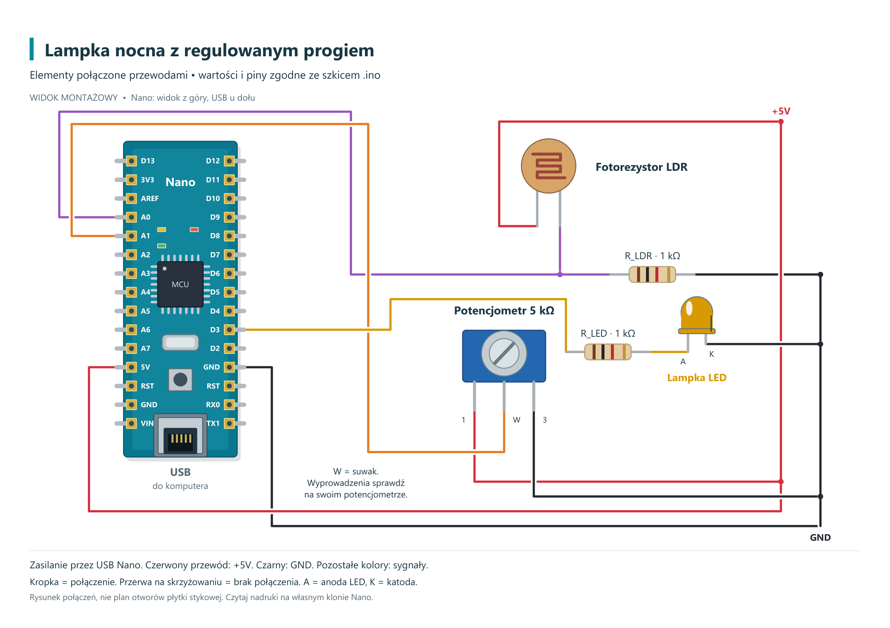

# Czujnik oświetlenia do hodowli roślin z regulowanym progiem

Po zapadnięciu zmroku i zmniejszeniu padania światła na fotorezystor, dodatkowe źródło światła do wsparcia hodowli płynnie się rozjaśnia. Potencjometr reguluje próg wykrywania ciemności. Histereza ogranicza przełączanie na granicy.

## Elementy z zestawu

- Nano 5 V, USB, płytka stykowa i przewody
- fotorezystor — 1 szt.
- potencjometr 5 kΩ — 1 szt.
- LED, np. żółta — 1 szt.
- rezystory 1 kΩ — 2 szt.: do LED i do dzielnika

Projekty wykonujesz kolejno, wykorzystując ponownie tę samą płytkę i części. Przewód USB oraz komputer to stanowisko do zasilania i wgrywania kodu.

## Schemat i połączenia

[Otwórz schemat w pełnej rozdzielczości](schemat_montazowy.png).

Nano pokazano z góry, z USB u dołu i kolejnością pinów klasycznego Nano. Połączenia wykonuj według oznaczeń na własnej płytce. To widok elementów i przewodów; grupy otworów płytki stykowej trzeba dobrać samodzielnie.

**Czerwony przewód: +5V. Czarny: GND. Pozostałe kolory: sygnały.** Kropka oznacza połączenie, a przerwa przy skrzyżowaniu — brak połączenia. A to anoda LED, K — katoda. Każda LED ma własny rezystor 1 kΩ.

| Od | Do | Uwagi |
|---|---|---|
| Nano 5V | Jedna nóżka fotorezystora | LDR nie ma polaryzacji |
| Druga nóżka LDR | Nano A0 oraz jeden koniec R_LDR 1 kΩ | Wspólny węzeł pomiarowy |
| Drugi koniec R_LDR | Nano GND | Dzielnik: +5V → LDR → A0 → R_LDR → GND |
| Skrajne końce ścieżki potencjometru | Nano 5V i Nano GND | Nie zwieraj suwaka do obu szyn |
| Suwak potencjometru | Nano A1 | Sprawdź wyprowadzenie suwaka |
| Nano D3 | R_LED 1 kΩ → anoda LED | D3 obsługuje PWM w klasycznym Nano |
| Katoda LED | Nano GND | Wspólna masa |

## Montaż i uruchomienie

Przepinaj elementy przy odłączonym USB. Obie nóżki LED muszą należeć do różnych węzłów; każda LED ma własny rezystor. Sprawdź, czy szyny płytki stykowej są ciągłe, i w razie potrzeby połącz ich segmenty.

1. Połącz dzielnik LDR i rezystora dokładnie w podanej kolejności.
2. Podłącz potencjometr i LED przez osobny rezystor. Umieść LED tak, aby nie świeciła bezpośrednio na LDR.
3. Wgraj kod, otwórz Serial 9600 i obserwuj wartości Swiatlo ADC, prog i PWM.
4. Pokrętłem dobierz próg do sali. Zasłoń LDR dłonią, a potem go odsłoń.

Otwórz **czujnik_swiatla.ino** w Arduino IDE. Nie instalujesz dodatkowych bibliotek. Wybór płytki i portu opisano w [instrukcji uruchomienia](../../README.md#uruchomienie).

## Sprawdzenie na stanowisku

Poniższe testy należy wykonać na złożonym układzie. Oczekiwane wyniki nie oznaczają, że zestaw ze zdjęcia został fizycznie przetestowany.

| Próba | Oczekiwany wynik |
|---|---|
| LDR odsłonięty, próg ustawiony poniżej odczytu światła | LED stopniowo gaśnie; PWM dochodzi do 0. |
| LDR zasłonięty, próg powyżej odczytu światła | LED rozjaśnia się; PWM rośnie. |
| Powolna zmiana jasności blisko progu | Histereza ±15 jednostek ADC ogranicza częste przełączanie. |
| Pokrętło od minimum do maksimum | Próg zmienia się w zakresie 20–1000; program nie dzieli przez zero. |

## Co wyjaśnić uczniom

dzielnik napięcia, analogRead(), PWM, histereza, filtrowanie i łagodne zmiany jasności.

W pokazanym połączeniu większa jasność zwykle daje większy odczyt A0. Wartości są jednostkami ADC, a nie luksami. Rezystancja LDR zależy od oświetlenia, więc próg dobierasz do warunków. Wykorzystujemy dostępny rezystor 1 kΩ; zakres odczytów może być wąski. Nie dodawaj napięcia 9 V do dzielnika.

## Zadania dodatkowe

- Zmień HYSTERESIS z 15 na 5 i porównaj stabilność.
- Zmień krok jasności z 5 na 1; zmierz czas rozjaśniania.

## Gdy coś nie działa

- Sprawdź zgodność modelu i logiki 5 V oraz wybraną płytkę i port w IDE.
- Sprawdź wspólną masę i rzeczywiste grupy po pięć otworów w breadboardzie.
- Sprawdź polaryzację LED, wartość rezystora i zgodność numeru pinu z kodem.

## Weryfikacja i źródła

Kod sprawdzono przez kompilację dla ATmega328P 16 MHz z Arduino AVR Boards 1.8.8 oraz testy logiki z symulowanymi wejściami. Nie wykonano prób na fizycznym zestawie. Testy stanowiskowe powyżej wykonaj po złożeniu układu.

[Odczyt fotorezystora](https://learn.adafruit.com/photocells/using-a-photocell) · [Arduino analogWrite()](https://docs.arduino.cc/language-reference/en/functions/analog-io/analogWrite/)

[← Wszystkie projekty](../../README.md)
