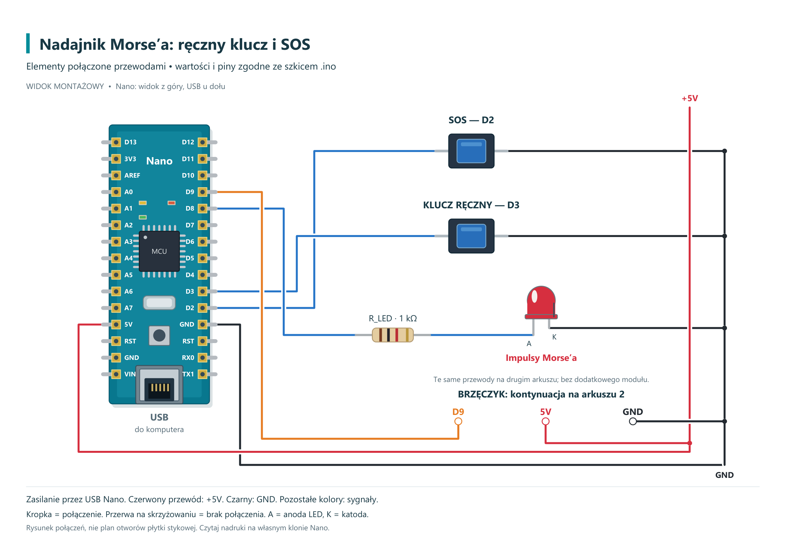
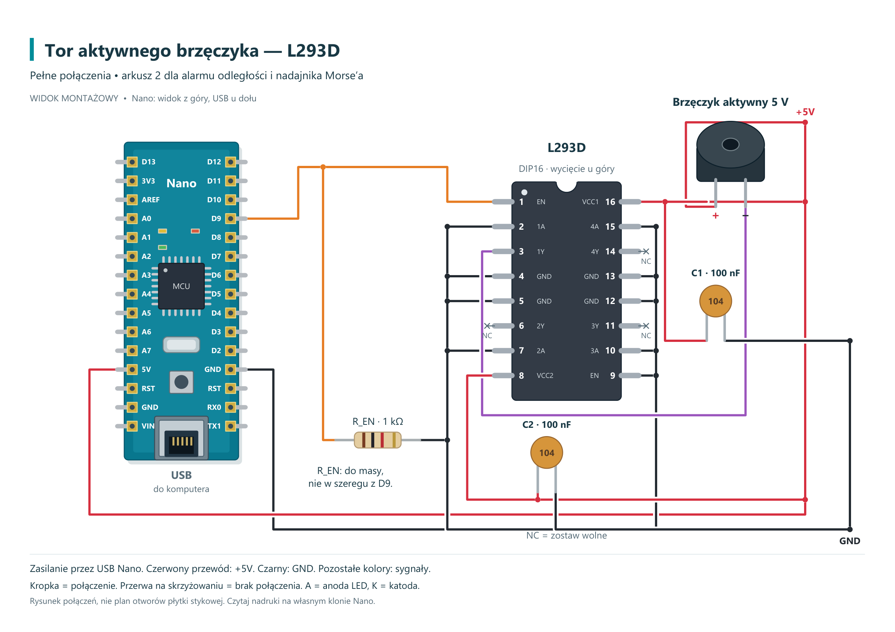

# Nadajnik Morse’a: ręczny klucz i SOS

**Poziom:** średni · **Czas orientacyjny:** 60–90 min · **Płytka:** klasyczne Nano / zgodny klon z logiką 5 V.

Jeden przycisk nadaje automatycznie SOS (...---...) jako jeden ciągły znak, drugi działa jak ręczny klucz. LED i brzęczyk pokazują te same impulsy.

## Elementy z zestawu

- Nano 5 V, USB, płytka stykowa i przewody
- przyciski chwilowe — 2 szt.
- LED, np. czerwona — 1 szt.; rezystor 1 kΩ do LED — 1 szt.
- aktywny brzęczyk — 1 szt.; L293D — 1 szt.
- rezystor 1 kΩ R_EN — 1 szt.; kondensatory 100 nF — 2 szt.

Projekty wykonujesz kolejno, wykorzystując ponownie tę samą płytkę i części. Przewód USB oraz komputer to stanowisko do zasilania i wgrywania kodu.

## Schemat i połączenia

[Otwórz schemat w pełnej rozdzielczości](schemat_montazowy.png).

Nano pokazano z góry, z USB u dołu i kolejnością pinów klasycznego Nano. Połączenia wykonuj według oznaczeń na własnej płytce. To widok elementów i przewodów; grupy otworów płytki stykowej trzeba dobrać samodzielnie.

**Czerwony przewód: +5V. Czarny: GND. Pozostałe kolory: sygnały.** Kropka oznacza połączenie, a przerwa przy skrzyżowaniu — brak połączenia. A to anoda LED, K — katoda. Każda LED ma własny rezystor 1 kΩ.

| Od | Do | Uwagi |
|---|---|---|
| Nano D2 | Przycisk SOS → GND | Start lub przerwanie automatycznego SOS |
| Nano D3 | Przycisk KLUCZ → GND | Ręczne nadawanie; ma pierwszeństwo |
| Nano D8 | Rezystor 1 kΩ → anoda LED | Wskaźnik impulsów |
| Katoda LED | Nano GND | Wspólna masa |
| Nano D9 | L293D pin 1 (1,2EN) | Sterowanie EN_D9; HIGH = brzęczyk włączony |
| L293D pin 1 | Rezystor R_EN 1 kΩ → GND | Podciągnięcie EN do masy podczas resetu |
| Nano 5V | L293D piny 16 (VCC1) i 8 (VCC2) | Oba zasilania +5V |
| Nano GND | L293D piny 4, 5, 12, 13 | Wspólna masa |
| Nano GND | L293D piny 2 (1A), 7 (2A), 10 (3A), 15 (4A), 9 (3,4EN) | Stałe stany wejść |
| Nano 5V | Brzęczyk + | Zasilanie brzęczyka 5 V |
| Brzęczyk − | L293D pin 3 (1Y) | Net BUZ_MINUS; nie podłączaj tego końca bezpośrednio do GND |
| L293D pin 16 | C1 100 nF → GND | Blisko obudowy |
| L293D pin 8 | C2 100 nF → GND | Blisko obudowy |
| L293D piny 6, 11, 14 | Bez połączenia (NC) | To wyjścia; nie zwieraj do zasilania lub masy |

### Tor dźwięku — ważne przed montażem

Zmontuj również cały tor L293D z poniższego rysunku. Jest wymagany do działania dźwięku.

[Otwórz schemat toru brzęczyka w pełnej rozdzielczości](tor_brzeczyka_montazowy.png).

Brzęczyk ma być standardowym aktywnym modelem 5 V. Zdjęcie opakowania nie podaje jego napięcia i prądu: sprawdź nadruk lub dokumentację zestawu. Nie traktuj L293D jako ogranicznika napięcia. Układ ma spadek napięcia na wyjściu, więc brzęczyk dostaje mniej niż pełne 5 V i może grać ciszej. Jeżeli dany egzemplarz nie startuje, nie zastępuj toru połączeniem wprost z GPIO bez sprawdzenia prądu. To rzeczywista niepewność identyfikacji części ze zdjęcia.

W naszym połączeniu pin 2 L293D jest na GND. D9 steruje **EN, pin 1**: HIGH włącza wyjście 1Y w stan niski i prąd płynie przez brzęczyk; LOW odłącza wyjście do wysokiej impedancji. Rezystor R_EN 1 kΩ wycisza tor podczas resetu. Masa obu zasileń i Nano jest wspólna. Kondensatory 100 nF umieść blisko pinów 16 i 8. Wyjścia oznaczone NC zostaw wolne.

## Montaż i uruchomienie

Przepinaj elementy przy odłączonym USB. Obie nóżki LED muszą należeć do różnych węzłów; każda LED ma własny rezystor. Sprawdź, czy szyny płytki stykowej są ciągłe, i w razie potrzeby połącz ich segmenty.

1. Podłącz przyciski, LED oraz pełny tor brzęczyka L293D z osobnego schematu toru brzęczyka.
2. Wgraj szkic z Przycisk.h i otwórz Serial 9600.
3. Krótko naciśnij SOS: powinny pojawić się trzy krótkie, trzy długie i trzy krótkie sygnały.
4. Przytrzymaj KLUCZ. Sygnał trwa do puszczenia; przejście na ręczne nadawanie przerywa automat.

Otwórz **nadajnik_morsea.ino** w Arduino IDE. Pozostaw `Przycisk.h` w tym samym folderze. Nie instalujesz dodatkowych bibliotek. Wybór płytki i portu opisano w [instrukcji uruchomienia](../../README.md#uruchomienie).

## Sprawdzenie na stanowisku

Poniższe testy należy wykonać na złożonym układzie. Oczekiwane wyniki nie oznaczają, że zestaw ze zdjęcia został fizycznie przetestowany.

| Próba | Oczekiwany wynik |
|---|---|
| Jedno naciśnięcie SOS | Dokładnie 9 impulsów: 3 krótkie, 3 długie, 3 krótkie; potem cisza. |
| Pomiar czasów w kodzie | Kropka 180 ms, kreska 540 ms, każda wewnętrzna przerwa ciągłego SOS 180 ms. |
| Drugie naciśnięcie SOS w trakcie sekwencji | Sekwencja zatrzymuje się. |
| Przytrzymanie KLUCZA podczas SOS | Automat kończy się, LED i dźwięk włączone do puszczenia klucza. |

## Co wyjaśnić uczniom

kodowanie informacji, jednostka czasu, tablice, automat stanów i priorytet wejść.

Brzęczyk jest aktywny: jego własny generator wytwarza dźwięk po włączeniu. Program zmienia rytm, a nie wysokość tonu, dlatego nie używa tone(). Jedno SOS trwa nominalnie około 4,14 s. SOS nadajemy jako jeden znak, bez wydłużonych przerw między grupami S/O/S. Przy nadawaniu zwykłych oddzielnych liter przerwa ma 3 jednostki, a między słowami 7. Automatyczna sekwencja kończy się ciszą.

## Zadania dodatkowe

- Zmień UNIT_MS na 250 i porównaj tempo.
- Nadaj ręcznie własne inicjały i poproś drugą osobę o odczyt.

## Gdy coś nie działa

- Sprawdź zgodność modelu i logiki 5 V oraz wybraną płytkę i port w IDE.
- Sprawdź wspólną masę i rzeczywiste grupy po pięć otworów w breadboardzie.
- Dla przycisku użyj dwóch styków, które łączą się dopiero po wciśnięciu; w zestawie etykieta wskazuje model dwunóżkowy.
- Sprawdź polaryzację LED, wartość rezystora i zgodność numeru pinu z kodem.

## Weryfikacja i źródła

Kod sprawdzono przez kompilację dla ATmega328P 16 MHz z Arduino AVR Boards 1.8.8 oraz testy logiki z symulowanymi wejściami. Nie wykonano prób na fizycznym zestawie. Testy stanowiskowe powyżej wykonaj po złożeniu układu.

[Międzynarodowy kod Morse’a — ITU](https://www.itu.int/dms_pubrec/itu-r/rec/m/R-REC-M.1677-1-200910-I!!PDF-E.pdf) · [L293D — dokumentacja TI](https://www.ti.com/lit/ds/symlink/l293d.pdf)

[← Wszystkie projekty](../../README.md)
