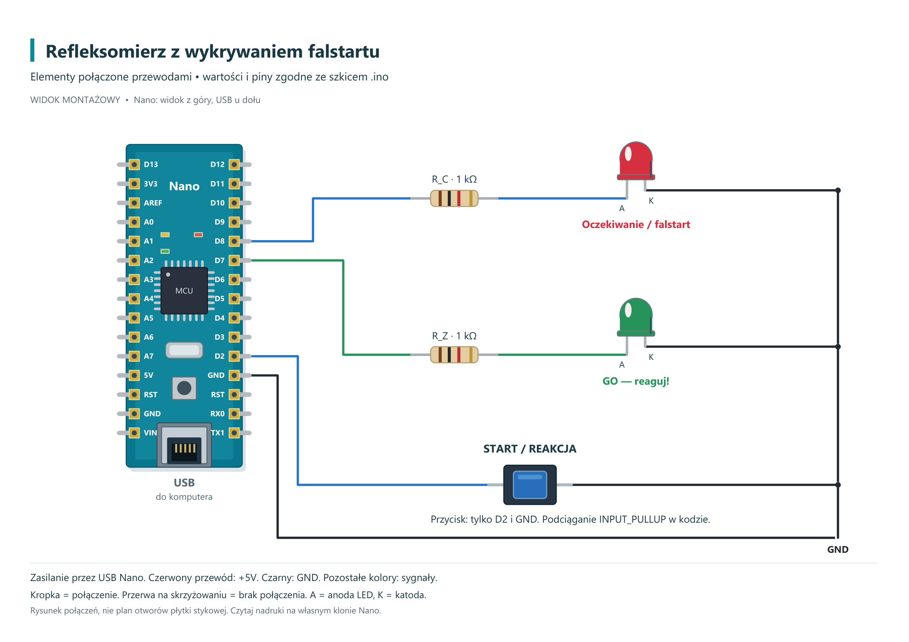

# Refleksomierz z wykrywaniem falstartu

**Poziom:** średni · **Czas orientacyjny:** 45–60 min · **Płytka:** klasyczne Nano / zgodny klon z logiką 5 V.

Naciśnij i puść przycisk, poczekaj na zieloną LED, a następnie naciśnij ponownie. Program pokazuje czas reakcji w milisekundach i wykrywa falstart.

## Elementy z zestawu

- Nano 5 V, USB, płytka stykowa i przewody
- przycisk chwilowy — 1 szt.
- LED czerwona i zielona — po 1 szt.
- rezystory 1 kΩ — 2 szt.

Projekty wykonujesz kolejno, wykorzystując ponownie tę samą płytkę i części. Przewód USB oraz komputer to stanowisko do zasilania i wgrywania kodu.

## Schemat i połączenia

[Otwórz schemat w pełnej rozdzielczości](schemat_montazowy.png).

Nano pokazano z góry, z USB u dołu i kolejnością pinów klasycznego Nano. Połączenia wykonuj według oznaczeń na własnej płytce. To widok elementów i przewodów; grupy otworów płytki stykowej trzeba dobrać samodzielnie.

**Czerwony przewód: +5V. Czarny: GND. Pozostałe kolory: sygnały.** Kropka oznacza połączenie, a przerwa przy skrzyżowaniu — brak połączenia. A to anoda LED, K — katoda. Każda LED ma własny rezystor 1 kΩ.

| Od | Do | Uwagi |
|---|---|---|
| Nano D2 | Jeden styk przycisku START/REAKCJA | INPUT_PULLUP w kodzie |
| Drugi styk przycisku | Nano GND | Wciśnięty = LOW |
| Nano D7 | Rezystor 1 kΩ → anoda zielonej LED | Sygnał GO |
| Katoda zielonej LED | Nano GND | Masa |
| Nano D8 | Rezystor 1 kΩ → anoda czerwonej LED | Oczekiwanie / falstart |
| Katoda czerwonej LED | Nano GND | Masa |

## Montaż i uruchomienie

Przepinaj elementy przy odłączonym USB. Obie nóżki LED muszą należeć do różnych węzłów; każda LED ma własny rezystor. Sprawdź, czy szyny płytki stykowej są ciągłe, i w razie potrzeby połącz ich segmenty.

1. Podłącz przycisk pomiędzy D2 i GND. Rezystor podciągający włącza program.
2. Każdą LED podłącz przez własny rezystor 1 kΩ.
3. Otwórz szkic razem z plikiem Przycisk.h w tym samym folderze. Wgraj, otwórz Serial 9600.
4. Naciśnij i puść przycisk. Zielona LED zapali się po losowym czasie około 1,5–5 s. Reaguj dopiero na zielony sygnał.

Otwórz **refleksomierz.ino** w Arduino IDE. Pozostaw `Przycisk.h` w tym samym folderze. Nie instalujesz dodatkowych bibliotek. Wybór płytki i portu opisano w [instrukcji uruchomienia](../../README.md#uruchomienie).

## Sprawdzenie na stanowisku

Poniższe testy należy wykonać na złożonym układzie. Oczekiwane wyniki nie oznaczają, że zestaw ze zdjęcia został fizycznie przetestowany.

| Próba | Oczekiwany wynik |
|---|---|
| Prawidłowy start, puszczenie i reakcja po zielonym | Monitor pokazuje Czas reakcji [ms]. |
| Drugie naciśnięcie przed zielonym | Komunikat FALSTART i szybkie miganie czerwonej LED. |
| Przycisk trzymany po starcie | Odliczanie zaczyna się dopiero po puszczeniu. |
| Brak reakcji przez 5 s po zielonym | Komunikat o braku reakcji; można rozpocząć kolejną próbę. |

## Co wyjaśnić uczniom

automat stanów, losowe opóźnienie, debounce, pomiar czasu i falstart.

Pomiar jest edukacyjny. Kod pamięta początek ostatniego stabilnego naciśnięcia, aby nie dodawać wprost całych 30 ms debounce do wyniku; drgania styków i czas przebiegu pętli nadal wpływają na wynik. Niepodłączone A7 służy jedynie jako prosty zarodek losowania. Po wyniku lub falstarcie program czeka 1,8 s oraz na puszczenie przycisku.

## Zadania dodatkowe

- Porównaj medianę pięciu prób zamiast jednego wyniku.
- Dodaj wypisanie najlepszego wyniku do Serial.

## Gdy coś nie działa

- Sprawdź zgodność modelu i logiki 5 V oraz wybraną płytkę i port w IDE.
- Sprawdź wspólną masę i rzeczywiste grupy po pięć otworów w breadboardzie.
- Dla przycisku użyj dwóch styków, które łączą się dopiero po wciśnięciu; w zestawie etykieta wskazuje model dwunóżkowy.
- Sprawdź polaryzację LED, wartość rezystora i zgodność numeru pinu z kodem.

## Weryfikacja i źródła

Kod sprawdzono przez kompilację dla ATmega328P 16 MHz z Arduino AVR Boards 1.8.8 oraz testy logiki z symulowanymi wejściami. Nie wykonano prób na fizycznym zestawie. Testy stanowiskowe powyżej wykonaj po złożeniu układu.

[Arduino INPUT_PULLUP](https://docs.arduino.cc/built-in-examples/digital/InputPullupSerial/) · [Arduino Debounce](https://docs.arduino.cc/built-in-examples/digital/Debounce/)

[← Wszystkie projekty](../../README.md)
