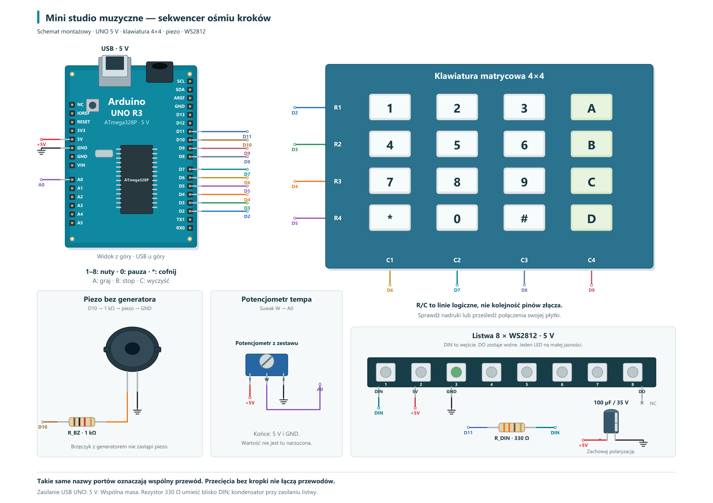

# Mini studio muzyczne — sekwencer ośmiu kroków

**Poziom:** średni · **Płytka:** Arduino Uno R3 / klasyczne Nano ATmega328P, 5 V · **Części:** FORBOT Arduino I i II.

Ułóż własną jednogłosową melodię z **maksymalnie ośmiu nut lub pauz**. Klawiatura wpisuje kolejne kroki, pokrętło reguluje tempo, piezo odtwarza melodię w pętli, a jeden świecący punkt WS2812 wskazuje aktualny krok. Sekwencja jest zapisywana w RAM i znika po wyłączeniu lub restarcie płytki.

[Kod Arduino](sekwencer_muzyczny.ino) · [Karta pracy](KARTA_PRACY.md) · [Schemat montażowy](schemat_montazowy.png) · [Schemat elektryczny](schemat_elektryczny.png)

## Potrzebne elementy

| Element | Ilość | Zastosowanie / zestaw |
|---|---:|---|
| Arduino Uno R3 lub klasyczne Nano, ATmega328P 5 V | 1 | Płytka z poziomu I. |
| Klawiatura matrycowa 4×4, 16 przycisków | 1 | Poziom II; zidentyfikuj jej rzędy i kolumny. |
| Piezo bez generatora, 23 mm | 1 | Poziom II; zmienna wysokość dźwięku. |
| Listwa 8 LED RGB WS2812 | 1 | Poziom II; znacznik kroku. |
| Potencjometr montażowy z zestawu | 1 | Poziom I; regulacja tempa. |
| Rezystor 1 kΩ | 1 | Szeregowo z piezo. |
| Rezystor 330 Ω | 1 | Szeregowo z wejściem DIN listwy. |
| Kondensator elektrolityczny 100 µF / 35 V | 1 | Poziom II; przy zasilaniu listwy. |
| Płytka stykowa, przewody, kabel USB | 1 komplet | Z obu zestawów. |
| Komputer z Arduino IDE | 1 | Programowanie i opcjonalny Monitor portu szeregowego. |

Skład zestawów: [poziom I](https://botland.com.pl/zestawy-i-kursy-forbot/12642-zestaw-forbot-do-kursu-arduino-min-z-mikrokontrolerem-plytka-stykowa-materialy-edukacyjne-5903351242899.html), [poziom II](https://botland.com.pl/zestawy-i-kursy-forbot/11819-forbot-arduino-poziom-2-zestaw-elementow-kurs-on-line-5903351242868.html). Wartość potencjometru nie jest określona w opisie zestawu. Wykorzystujemy **brzęczyk bez generatora**; wersja z generatorem z poziomu I nie odtworzy w ten sam sposób zadanych częstotliwości.

## Schematy i połączenia



[Powiększ schemat montażowy](schemat_montazowy.png) · [Schemat elektryczny](schemat_elektryczny.png)

Układ jest zasilany z **USB Arduino, 5 V**, ze wspólną masą. Zasilacz 12 V z zestawu II nie jest tu używany. Powtarzające się nazwy węzłów oznaczają połączenie, a przecięcia przewodów bez kropek go nie tworzą. Położenie otworów breadboardu dobierz według rzeczywistych grup styków.

| Element | Połączenie z Arduino / układem |
|---|---|
| Rzędy klawiatury R1, R2, R3, R4 | D2, D3, D4, D5 |
| Kolumny klawiatury C1, C2, C3, C4 | D6, D7, D8, D9 |
| Piezo bez generatora | D10 → 1 kΩ → piezo → GND |
| DIN listwy WS2812 | D11 przez 330 Ω; rezystor blisko DIN |
| Zasilanie listwy | 5 V i GND |
| DO / DOUT listwy | Wolne |
| Kondensator 100 µF | Równolegle przy listwie: plus do 5 V, minus do GND |
| Potencjometr | Końce do 5 V i GND, suwak do A0 |

Szkic zapala **najwyżej jeden piksel**, z ograniczeniem jasności `setBrightness(16)`. Kondensator 100 µF z zestawu stanowi lokalne buforowanie dla tego małego układu USB. Przy rozbudowie listwy lub zwiększaniu jasności trzeba ponownie dobrać zasilanie i pojemność; Adafruit zaleca 500–1000 µF zwłaszcza przy dużych źródłach zasilania. Oznaczenie 35 V na kondensatorze jest jego napięciem znamionowym, a napięcie układu wynosi 5 V.

Sprawdź kierunek przepływu danych na listwie: przewód z D11 trafia do **DIN**, zgodnie ze strzałką prowadzącą do pierwszego piksela. Podłączaj elementy przy odłączonym USB. Jeśli moduł ma pola lutownicze zamiast złącza, potrzebuje pewnie zamocowanych przewodów lub listwy pinowej.

### Jak ustalić rzędy i kolumny klawiatury

Numeracja fizycznego złącza nie jest uniwersalna. Na schemacie użyto nazw logicznych R1–R4 i C1–C4, a nie wymyślonej kolejności ośmiu pinów. Zastosuj nadruki lub dokumentację swojej klawiatury; przy ich braku ustal połączenia miernikiem przy odłączonym zasilaniu. Każdy przycisk zwiera jeden rząd z jedną kolumną.

Mapa przyjęta w szkicu, patrząc na klawisze od przodu:

```text
       C1  C2  C3  C4
R1      1   2   3   A
R2      4   5   6   B
R3      7   8   9   C
R4      *   0   #   D
```

Jeżeli płytka nie ma takich nadruków, oznacz przyciski według tej mapy. Dla innego układu popraw `klawisze`, `pinyRzedow` i `pinyKolumn`. W tym ćwiczeniu naciskamy **jeden klawisz naraz**; macierz bez diod może przy kilku klawiszach dawać niejednoznaczny odczyt.

## Uruchomienie w Arduino IDE

1. Zmontuj układ przy odłączonym USB; sprawdź klawiaturę, polaryzację kondensatora i DIN listwy.
2. W Menedżerze bibliotek zainstaluj **Keypad** — Mark Stanley, Alexander Brevig / Community — oraz **Adafruit NeoPixel** — Adafruit. Sprawdzono wersje **3.1.1** i **1.15.5**.
3. Otwórz [sekwencer_muzyczny.ino](sekwencer_muzyczny.ino) w folderze `sekwencer_muzyczny`.
4. Wybierz **Arduino Uno** lub **Arduino Nano**, ATmega328P i bootloader zgodny ze swoją płytką; wybierz port i wgraj szkic.
5. Otwórz Monitor portu szeregowego, **9600 baud**, aby widzieć instrukcję, zapisane kroki i komunikaty. Klawisze naciskamy na fizycznej klawiaturze.
6. Wpisz przykładowo `1 2 3 0 3 2 1 0`, następnie `A`. Obróć pokrętło, a na końcu naciśnij `B`.

Po uruchomieniu pamięć jest pusta i wszystkie piksele są zgaszone. Wpisanie nuty daje **150 ms odsłuchu**. Zielony piksel oznacza nutę, niebieski pauzę. Po STOP listwa gaśnie.

## Obsługa

| Klawisz / element | Działanie |
|---|---|
| 1–8 | Dopisuje nutę C6, D6, E6, F6, G6, A6, B6, C7. Angielskie B odpowiada polskiemu H. |
| 0 | Dopisuje pauzę. |
| * | Usuwa ostatni krok. |
| A | Startuje lub ponownie rozpoczyna od pierwszego kroku; zapętla 1–8 wpisanych kroków. |
| B | Zatrzymuje odtwarzanie i umożliwia edycję. |
| C | Czyści program, gdy odtwarzanie jest zatrzymane. |
| 9, #, D | Bez funkcji; Monitor wyjaśnia to po naciśnięciu. |
| Potencjometr | Ustawia 60–240 BPM; nowa wartość obowiązuje od następnego kroku. |

Edycja nut, cofanie i kasowanie wymagają wcześniejszego STOP. Pusty program nie jest odtwarzany; dziewiąty krok nie zostanie dopisany. Zapisane są numery nut i pauz. Częstotliwości nut w kodzie to kolejno **1047, 1175, 1319, 1397, 1568, 1760, 1976 i 2093 Hz**.

## Rytm i działanie programu

Jeden krok jest ćwierćnutą: `czasKroku = 60000 / BPM` w milisekundach. Przy 60 BPM trwa 1000 ms, przy 120 BPM 500 ms, przy 240 BPM 250 ms. Dźwięk zajmuje około 80% kroku, a końcowe 20% stanowi przerwę. Pauza zajmuje cały krok.

Tablica `sekwencja[8]` przechowuje program. Biblioteka Keypad skanuje matrycę i stosuje 30 ms eliminacji drgań; przytrzymanie klawisza nie dopisuje go wielokrotnie. `millis()` zarządza krokami. Funkcja `tone()` wytwarza przebieg, a `noTone()` zatrzymuje go przed przesłaniem nowych danych do WS2812. Po dłuższym zatrzymaniu pętli program przechodzi o jeden krok, bez lawiny nadrabianych dźwięków.

To prosty instrument edukacyjny: odczyty, komunikaty Serial i obsługa biblioteki wprowadzają opóźnienia. Podane czasy są nominalne. Głośność zależy od modelu piezo i częstotliwości; pokrętło reguluje tempo, a nie głośność.

## Próby i rozwiązywanie problemów

| Próba / objaw | Oczekiwany wynik lub czynność |
|---|---|
| A przy pustej pamięci | Informacja o pustym programie, brak odtwarzania. |
| Wpisz 1, 0, A | Naprzemiennie nuta i pauza, zielony/niebieski znacznik. |
| Wpisz osiem kroków, potem kolejny | Pamięć pozostaje przy ośmiu krokach. |
| Obróć pokrętło podczas gry | Tempo zmienia się od początku następnego kroku. |
| B, *, C | STOP, usunięcie końcowego kroku, wyczyszczenie pamięci. |
| Po naciśnięciu widoczny jest inny klawisz | Ustal rzeczywiste R/C i orientację macierzy; popraw połączenia lub mapę. |
| Brak dźwięku / stały pisk | Sprawdź typ piezo, D10, rezystor i masę; stały generator nie zastąpi wymaganego piezo bez generatora. |
| Listwa nie działa | Sprawdź DIN zamiast DO, 5 V, GND, rezystor i pewność połączeń. |
| Zamienione barwy | Sprawdź typ listwy i kolejność barw; szkic zakłada WS2812 z `NEO_GRB + NEO_KHZ800`. |

Kompilacja i linkowanie dla **Uno i klasycznego Nano, ATmega328P 16 MHz**, z **Arduino AVR Boards 1.8.8**, **Keypad 3.1.1** i **Adafruit NeoPixel 1.15.5**: **8384 B Flash, 462 B statycznego RAM**, bez ostrzeżeń szkicu i bibliotek. Dziewięć grup testów logiki sprawdziło pamięć, nuty/pauzy, sterowanie, tempo, czasy, LED i zawinięcie `millis()`. **Nie przeprowadzono próby na fizycznym zestawie.**

## Źródła

- [Arduino Uno — pinout](https://docs.arduino.cc/resources/pinouts/A000066-full-pinout.pdf) i [klasyczne Nano — pinout](https://docs.arduino.cc/resources/pinouts/A000005-full-pinout.pdf).
- [FORBOT — piezo bez generatora i tone()](https://forbot.pl/blog/kurs-arduino-ii-syrena-alarmowa-mosfet-w-praktyce-id15497).
- [Arduino — odtwarzanie melodii i tablica częstotliwości](https://docs.arduino.cc/built-in-examples/digital/toneMelody/).
- [Keypad — biblioteka autorów](https://github.com/Chris--A/Keypad/tree/3.1.1).
- [Adafruit NeoPixel 1.15.5](https://github.com/adafruit/Adafruit_NeoPixel/tree/1.15.5) i [zalecenia połączeń](https://learn.adafruit.com/adafruit-neopixel-uberguide/best-practices).

[← Wszystkie projekty Arduino](https://github.com/frogmaker/Arduino#wybierz-projekt)
