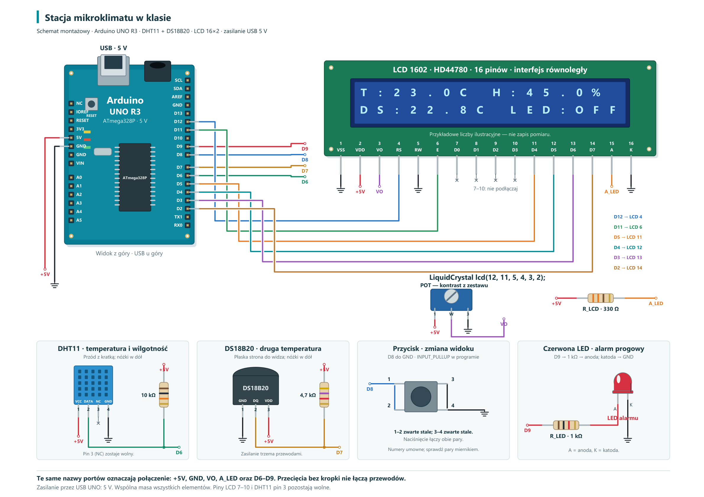

# Stacja mikroklimatu w klasie

**Poziom:** podstawowy/średni · **Płytka:** Arduino Uno R3, ATmega328P, 5 V · **Części:** zestawy FORBOT Arduino I i II.

Zbuduj stację pokazującą **temperaturę i wilgotność powietrza na LCD 16×2**. DHT11 mierzy obie wielkości, a drugi termometr DS18B20 pozwala porównać wskazania dwóch różnych czujników. Przycisk przełącza widoki bieżące oraz MIN/MAX. Czerwona LED sygnalizuje przekroczenie ustalonych progów z histerezą.

[Kod Arduino](stacja_mikroklimatu.ino) · [Karta pracy ucznia](KARTA_PRACY.md) · [Schemat montażowy](schemat_montazowy.png) · [Schemat elektryczny](schemat_elektryczny.png)

## Jak działa

- Nowy cykl pomiaru rozpoczyna się nominalnie **co 2 sekundy**. DHT11 jest odczytywany na początku cyklu; DS18B20 kończy swój pomiar około 750 ms później.
- Pierwsze dane DHT pojawiają się po około 2 s od inicjalizacji, a pełny zestaw trzech wyników po około 2,75 s. Wcześniej LCD pokazuje oczekiwanie.
- Krótkie naciśnięcie przycisku przełącza kolejno: **bieżące wyniki → MIN/MAX temperatury DHT → MIN/MAX wilgotności → MIN/MAX temperatury DS → bieżące wyniki**. Przytrzymanie nie przewija kolejnych ekranów.
- Minima i maksima są liczone od uruchomienia, osobno dla każdego pomiaru. Restart zeruje historię; zmiana widoku jej nie kasuje.
- LED zapala się przy temperaturze DHT **≥26°C** lub wilgotności **≥70% RH**. Przyczyna temperaturowa ustępuje przy **≤25°C**, a wilgotnościowa przy **≤65% RH**. LED gaśnie, kiedy obie przyczyny ustąpią.
- Niepoprawny odczyt nie aktualizuje swoich ekstremów. Błąd DHT gasi LED, a na LCD pojawiają się `ERR` i `AL:?`; zgaszona LED nie potwierdza wtedy poprawnych warunków.

To ćwiczenie pomiarowe. Progi 26°C i 70% są przykładowymi ustawieniami programu, a nie normą warunków w sali.

## Potrzebne elementy

| Element | Ilość | Zestaw / zastosowanie |
|---|---:|---|
| Arduino Uno R3, ATmega328P, 5 V | 1 | Poziom I; kod działa również na klasycznym Nano ATmega328P 5 V. |
| LCD 1602 zgodny z HD44780, 5 V, złącze równoległe 16-pinowe | 1 | Poziom I; wersja ze złączami. |
| Potencjometr montażowy z zestawu | 1 | Poziom I; regulacja kontrastu LCD. |
| DHT11, czujnik z czterema wyprowadzeniami | 1 | Poziom II; temperatura i wilgotność. |
| DS18B20, obudowa TO-92, trzy wyprowadzenia | 1 | Poziom II; drugi pomiar temperatury. |
| Przycisk tact-switch | 1 | Poziom I; zmiana widoku. |
| Czerwona LED | 1 | Poziom I; alarm progowy. |
| Rezystor 330 Ω | 1 | Poziom I; podświetlenie LCD. |
| Rezystor 1 kΩ | 1 | Poziom I lub II; ograniczenie prądu LED. |
| Rezystor 10 kΩ | 1 | Poziom II; podciąganie DATA czujnika DHT11. |
| Rezystor 4,7 kΩ | 1 | Poziom II; podciąganie DQ czujnika DS18B20. |
| Płytki stykowe i przewody | 1 komplet | Z obu zestawów; rozmieść elementy zgodnie z grupami styków. |
| Kabel USB i komputer z Arduino IDE | 1 komplet | Kabel pasujący do używanej płytki. |

Skład sprawdzono w opisach [FORBOT — poziom I](https://botland.com.pl/zestawy-i-kursy-forbot/12642-zestaw-forbot-do-kursu-arduino-min-z-mikrokontrolerem-plytka-stykowa-materialy-edukacyjne-5903351242899.html) i [poziom II](https://botland.com.pl/zestawy-i-kursy-forbot/11819-forbot-arduino-poziom-2-zestaw-elementow-kurs-on-line-5903351242868.html). Opis zestawu nie określa wartości potencjometru, dlatego nie przypisano mu konkretnej rezystancji. Standardowy poziom II nie zawiera drugiego Uno.

## Schematy i zasilanie



[Powiększ schemat montażowy](schemat_montazowy.png) · [Arkusz połączeń elektrycznych](schemat_elektryczny.png)

Cały układ zasilany jest z **USB płytki Arduino, 5 V**. Wszystkie elementy mają wspólną masę GND. Zasilacz 12 V z zestawu II i bateria 9 V nie są potrzebne; nie podłączaj ich bezpośrednio do szyn 5 V, czujników ani LCD.

Rysunek pokazuje Uno z góry, z USB u góry. Powtarzające się oznaczenia `+5V`, `GND`, `VO`, `A_LED` i `D6`–`D9` oznaczają wspólne połączenia. Przecięcia przewodów bez kropki nie tworzą połączenia. Schemat przedstawia połączenia elementów, a nie numerowane otwory breadboardu. Liczby na narysowanym LCD są ilustracją, nie zapisem pomiaru.

### LCD i potencjometr

Używany jest interfejs równoległy, 4-bitowy: `LiquidCrystal lcd(12, 11, 5, 4, 3, 2);`.

| Pin LCD | Funkcja | Połączenie |
|---:|---|---|
| 1 | VSS | GND |
| 2 | VDD / VCC | 5 V |
| 3 | VO | Suwak potencjometru kontrastu |
| 4 | RS | Arduino D12 |
| 5 | R/W | GND |
| 6 | E | Arduino D11 |
| 7–10 | D0–D3 | Wolne |
| 11 | D4 | Arduino D5 |
| 12 | D5 | Arduino D4 |
| 13 | D6 | Arduino D3 |
| 14 | D7 | Arduino D2 |
| 15 | A / LED+ | 5 V przez 330 Ω |
| 16 | K / LED− | GND |

Skrajne końce potencjometru połącz z 5 V i GND, a suwak z VO. Sprawdź jego wyprowadzenia. Dodatkowy rezystor 330 Ω może zmniejszyć jasność, jeśli moduł ma już własny rezystor podświetlenia. LCD z wyprowadzeniami tylko `GND/VCC/SDA/SCL` wymaga innego kodu i schematu.

### Czujniki, przycisk i LED

| Element | Wyprowadzenie | Połączenie |
|---|---|---|
| DHT11, przód z kratką do obserwatora, nóżki w dół | 1 / VCC | 5 V |
| DHT11 | 2 / DATA | D6 oraz rezystor 10 kΩ do 5 V |
| DHT11 | 3 / NC | Wolne |
| DHT11 | 4 / GND | GND |
| DS18B20 TO-92, płaski przód do obserwatora, nóżki w dół | Lewa, 1 / GND | GND |
| DS18B20 | Środkowa, 2 / DQ | D7 oraz rezystor 4,7 kΩ do 5 V |
| DS18B20 | Prawa, 3 / VDD | 5 V |
| Przycisk | Dwa styki łączone dopiero po naciśnięciu | D8 i GND |
| Czerwona LED | Anoda | D9 przez 1 kΩ |
| Czerwona LED | Katoda | GND |

DS18B20 pracuje tutaj z trzema przewodami i osobnym VDD; program odrzuca tryb zasilania pasożytniczego. Nie pomyl jego obudowy z LM35 lub tranzystorem — odczytaj oznaczenie. Dla modułów DHT11 z trzema pinami kieruj się ich nadrukami; kolejność może być inna i moduł może mieć własny rezystor.

**Czteronóżkowy przycisk ma dwie pary styków zwarte na stałe.** D8 i GND muszą trafić do różnych par. Na rysunku numery przycisku są umowne; sprawdź połączenia miernikiem przed montażem. Program używa `INPUT_PULLUP`, więc naciśnięcie daje stan LOW. W klasycznym Nano zachowaj te same oznaczenia D2–D9, D11, D12, 5V i GND, ale dobierz je według jego pinoutu.

## Uruchomienie w Arduino IDE

1. Odłącz USB. Zmontuj układ, sprawdź orientację czujników, rezystory podciągające i wspólną masę.
2. W Menedżerze bibliotek zainstaluj biblioteki z tabeli poniżej. Dla DHT zaakceptuj instalację zależności **Adafruit Unified Sensor**; sprawdź też obecność **OneWire**.
3. Otwórz [stacja_mikroklimatu.ino](stacja_mikroklimatu.ino), pozostawiając plik w folderze `stacja_mikroklimatu`.
4. Wybierz **Arduino AVR Boards → Arduino Uno**, właściwy port i wgraj szkic. Dla klasycznego Nano wybierz **Arduino Nano**, procesor ATmega328P oraz bootloader odpowiedni dla swojej płytki.
5. Wyreguluj kontrast potencjometrem i poczekaj około 3 s na pierwsze pełne wyniki.
6. Naciskaj przycisk, aby przełączać cztery widoki. Monitor lub Kreślarz portu szeregowego ustaw na **9600 baud**.

| Biblioteka w Menedżerze bibliotek | Autor / utrzymujący | Sprawdzona wersja |
|---|---|---:|
| LiquidCrystal | Arduino, Adafruit | 1.0.7 |
| DHT sensor library | Adafruit | 1.4.7 |
| Adafruit Unified Sensor | Adafruit | 1.1.15 |
| OneWire | Paul Stoffregen i współautorzy | 2.3.8 |
| DallasTemperature | Miles Burton i współautorzy | 4.0.6 |

## Widoki, błędy i dane szeregowe

Na głównym ekranie `T` oznacza temperaturę DHT w °C, `H` wilgotność względną w %, `DS` temperaturę DS18B20, a `AL` stan alarmu: `0` — brak przekroczenia według progów, `1` — alarm, `?` — brak poprawnego kompletu danych DHT. LCD używa znaków ASCII, dlatego jednostkę temperatury zapisuje jako `C`.

`ERR` oznacza brak poprawnego odczytu. Znak `!` na końcu wiersza MIN/MAX oznacza, że aktualny odczyt tego kanału jest błędny; zachowane liczby są historyczne. `---` oznacza, że nie było jeszcze żadnego poprawnego wyniku.

Serial wysyła **trzy liczby oddzielone przecinkami**, z kropką dziesiętną i zakończeniem wiersza:

```text
23.0,45.0,23.4
```

To wyłącznie przykład formatu, a nie zebrane dane. Kolejność: **temperatura DHT [°C], wilgotność [% RH], temperatura DS [°C]**. Program nie wysyła nagłówków ani komunikatów tekstowych. Nowy wiersz powstaje tylko wtedy, gdy wszystkie trzy pomiary z danego cyklu są poprawne; przy awarii transmisja tych wierszy ustaje. Błąd jednego czujnika nie zatrzymuje aktualizacji statystyk drugiego.

Dla opcjonalnej współpracy z [systemem wykresów na Pico 2 W](https://github.com/frogmaker/Projekty_Arduino/tree/main/projekty/system_sygnalu) zmień `Serial.begin(9600)` na `Serial.begin(115200)`. Podłącz TX Arduino do RX Pico **przez dzielnik napięcia opisany w tamtym projekcie** i połącz masy. Pico nie jest częścią zestawów FORBOT. Źródło wysyła 2–3 rekordy w ciągu 5 s, ale Pico pomija pierwszy wiersz przy synchronizacji, więc wykres zwykle zawiera tylko **1–2 punkty**. Do dłuższej obserwacji mikroklimatu warto osobno wydłużyć okno rejestratora; nie przyspieszaj odczytów DHT poniżej 2 s.

## Zmiana ustawień i zasada programu

Na początku szkicu są stałe `OKRES_MS`, `PROG_T`, `HISTEREZA_T`, `PROG_H` i `HISTEREZA_H`. Zmieniając je, zachowaj odstęp odczytów DHT **co najmniej 2000 ms**. Histereza wilgotności 5 oznacza pięć punktów procentowych, np. od 70% do 65% RH.

`millis()` wyznacza cykle, a DS18B20 pracuje asynchronicznie: program zleca konwersję, dalej obsługuje przycisk i dopiero po co najmniej 750 ms sprawdza wynik. Eliminacja drgań wymaga 30 ms stabilnego stanu przycisku. Sama komunikacja z czujnikami nadal zajmuje krótki czas procesora; kod nie używa dwusekundowego `delay()` zatrzymującego całą pętlę.

Program ponawia szukanie DS18B20 po błędzie, także jeśli nie było go podczas startu. Odczytuje go dopiero po zakończeniu konwersji; nie uznaje każdej wartości 85°C za awarię, ponieważ taka temperatura może być prawdziwa.

## Co rzeczywiście mierzymy

DHT11 jest czujnikiem do prostych doświadczeń: według dokumentacji ma typową rozdzielczość 1°C i 1% RH, dokładność temperatury do ±2°C oraz wilgotności ±5 punktów procentowych RH w określonych warunkach. Konserwatywny zakres używany w przewodniku Adafruit to 0–50°C i 20–80% RH. Samo wyświetlenie miejsca po przecinku nie zwiększa dokładności. Kod odrzuca błędną ramkę, temperaturę poza 0–50°C i wilgotność poza 0–100%; akceptowanie liczby nie rozszerza gwarantowanego zakresu czujnika.

DS18B20 jest zasilany napięciem 3–5,5 V i ma deklarowaną dokładność ±0,5°C w zakresie −10…+85°C. Przy 12 bitach krok wynosi 0,0625°C, a konwersja może trwać do 750 ms. To różne parametry: krok odczytu nie jest dokładnością. W tym szkicu wynik jest prezentowany z jednym miejscem po przecinku.

Do porównania połóż oba czujniki obok siebie, z dala od procesora, podświetlenia LCD i przeciągu; zaczekaj na ustalenie temperatury. Pomiary nie są równoczesne, a obudowy mogą różnie szybko reagować. DHT11 i gołego DS18B20 z zestawu nie zanurzaj w wodzie.

## Próby po montażu

| Próba / objaw | Oczekiwane zachowanie lub czynność |
|---|---|
| Start | Oczekiwanie, potem wyniki; bez fikcyjnych zer udających pomiary. |
| Cztery krótkie naciśnięcia | Przejście przez cztery widoki i powrót do bieżących danych. |
| Przytrzymanie przycisku | Jedna zmiana widoku; kolejna dopiero po zwolnieniu i naciśnięciu. |
| Próg alarmu | Można tymczasowo ustawić `PROG_T` poniżej temperatury w sali, wgrać kod i sprawdzić LED. Potem przywróć ustawienie. |
| Czujnik niepodłączony przed włączeniem | `ERR`, brak pełnych rekordów CSV; poprawny drugi czujnik nadal aktualizuje swoje MIN/MAX. Przepinaj przy odłączonym zasilaniu. |
| DHT pokazuje ERR | Sprawdź D6, 10 kΩ DATA–5 V, orientację, zasilanie i krótkie przewody. |
| DS pokazuje ERR | Sprawdź oznaczenie DS18B20, D7, 4,7 kΩ DQ–5 V oraz osobne VDD; skontroluj, czy nie pomylono GND z VDD. |
| LCD pokazuje prostokąty | Wyreguluj kontrast, sprawdź R/W–GND oraz sześć przewodów sterujących. |
| Przycisk nie działa / stale naciśnięty | Sprawdź miernikiem pary połączone na stałe; D8 i GND muszą być po różnych stronach styku zwieranego naciśnięciem. |
| Różne temperatury | Porównaj położenie, czas ustalenia i dokładności czujników; nie dopisuj arbitralnej „korekty” tylko po to, by liczby były identyczne. |

Szkic skompilowano i zlinkowano dla **Uno i klasycznego Nano, ATmega328P 16 MHz**, z **Arduino AVR Boards 1.8.8** i bibliotekami z tabeli: **10 574 B Flash, 369 B statycznego RAM**. Kod szkicu nie zgłosił ostrzeżeń. Dziewięć grup testów logiki sprawdziło m.in. czasy, przycisk, histerezę, błędy, MIN/MAX i zawinięcie `millis()`. Testy z atrapami nie zastępują próby na sprzęcie; **nie wykonano pomiaru na fizycznym zestawie**.

## Źródła

- [Arduino Uno R3 — oficjalny pinout](https://docs.arduino.cc/resources/pinouts/A000066-full-pinout.pdf) i [klasyczne Nano](https://docs.arduino.cc/resources/pinouts/A000005-full-pinout.pdf).
- [Arduino LiquidCrystal — przykład HelloWorld](https://github.com/arduino-libraries/LiquidCrystal/blob/master/examples/HelloWorld/HelloWorld.ino).
- [Przykładowa karta LCD 16×2 — standard numeracji złącza](https://newhavendisplay.com/content/specs/NHD-0216K1Z-NSW-FBW-L.pdf); nie identyfikuje konkretnego modułu z zestawu.
- [Adafruit — DHT11, podłączenie i rezystor 10 kΩ](https://learn.adafruit.com/dht/connecting-to-a-dhtxx-sensor), [parametry DHT11](https://learn.adafruit.com/dht/overview) oraz [karta producenta Aosong](https://cdn-shop.adafruit.com/datasheets/DHT11-chinese.pdf).
- [Analog Devices — karta DS18B20](https://www.analog.com/media/en/technical-documentation/data-sheets/ds18b20.pdf).
- Biblioteki autorów: [DHT](https://github.com/adafruit/DHT-sensor-library), [Adafruit Unified Sensor](https://github.com/adafruit/Adafruit_Sensor), [OneWire](https://github.com/PaulStoffregen/OneWire), [DallasTemperature](https://github.com/milesburton/Arduino-Temperature-Control-Library/releases/tag/v4.0.6).

[← Wszystkie projekty Arduino](https://github.com/frogmaker/Arduino#wybierz-projekt)
