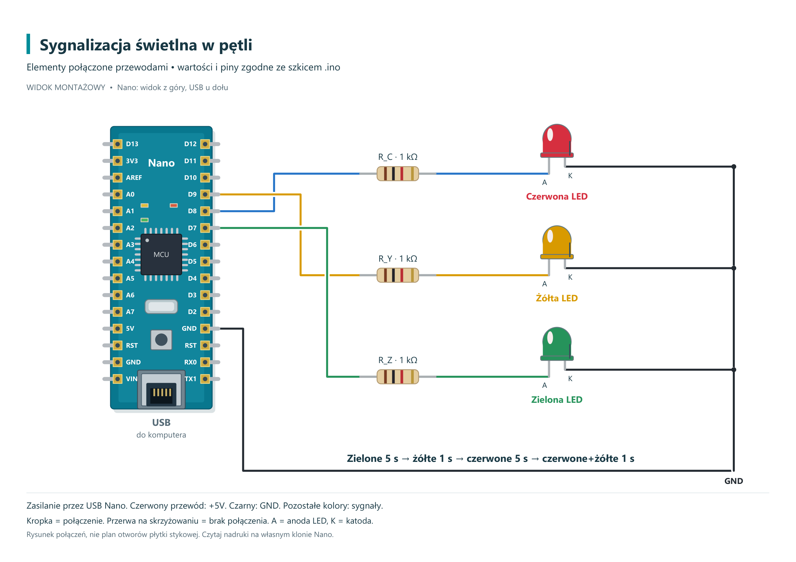

# Sygnalizacja świetlna w pętli

**Poziom:** podstawowy · **Czas orientacyjny:** 30–45 min · **Płytka:** klasyczne Nano / zgodny klon z logiką 5 V.

Zbuduj sygnalizator z trzech LED. Powtarzana kolejność: zielone 5 s → żółte 1 s → czerwone 5 s → czerwone razem z żółtym 1 s → ponownie zielone. Cały cykl trwa nominalnie 12 sekund.

## Elementy z zestawu

- Nano 5 V, USB, płytka stykowa i przewody
- LED: zielona, żółta i czerwona — po 1 szt.
- rezystory 1 kΩ — 3 szt., osobny do każdej LED

Projekty wykonujesz kolejno, wykorzystując ponownie tę samą płytkę i części. Przewód USB oraz komputer to stanowisko do zasilania i wgrywania kodu.

## Schemat i połączenia

[Otwórz schemat w pełnej rozdzielczości](schemat_montazowy.png).

Nano pokazano z góry, z USB u dołu i kolejnością pinów klasycznego Nano. Połączenia wykonuj według oznaczeń na własnej płytce. To widok elementów i przewodów; grupy otworów płytki stykowej trzeba dobrać samodzielnie.

**Czerwony przewód: +5V. Czarny: GND. Pozostałe kolory: sygnały.** Kropka oznacza połączenie, a przerwa przy skrzyżowaniu — brak połączenia. A to anoda LED, K — katoda. Każda LED ma własny rezystor 1 kΩ.

| Od | Do | Uwagi |
|---|---|---|
| Nano D7 | R_Z 1 kΩ → anoda zielonej LED | Światło zielone |
| Katoda zielonej LED | Nano GND | Wspólna masa |
| Nano D8 | R_C 1 kΩ → anoda czerwonej LED | Światło czerwone |
| Katoda czerwonej LED | Nano GND | Wspólna masa |
| Nano D9 | R_Y 1 kΩ → anoda żółtej LED | Światło żółte |
| Katoda żółtej LED | Nano GND | Wspólna masa |

## Montaż i uruchomienie

Przepinaj elementy przy odłączonym USB. Obie nóżki LED muszą należeć do różnych węzłów; każda LED ma własny rezystor. Sprawdź, czy szyny płytki stykowej są ciągłe, i w razie potrzeby połącz ich segmenty.

1. Ustaw trzy LED w kolejności fizycznej: u góry czerwona, pośrodku żółta, na dole zielona. Każda nóżka musi należeć do właściwego, oddzielnego węzła płytki stykowej.
2. Połącz każdą anodę z jej pinem Nano przez osobny rezystor 1 kΩ. Połącz wszystkie katody z GND.
3. Wgraj sygnalizacja_swietlna.ino. Dodatkowe biblioteki nie są potrzebne. Po uruchomieniu jako pierwsza świeci zielona LED.
4. Obserwuj kilka pełnych cykli. Opcjonalnie otwórz Monitor portu szeregowego 9600 baud — przy każdej zmianie program podaje nową fazę.

Otwórz **sygnalizacja_swietlna.ino** w Arduino IDE. Nie instalujesz dodatkowych bibliotek. Wybór płytki i portu opisano w [instrukcji uruchomienia](../../README.md#uruchomienie).

## Sprawdzenie na stanowisku

Poniższe testy należy wykonać na złożonym układzie. Oczekiwane wyniki nie oznaczają, że zestaw ze zdjęcia został fizycznie przetestowany.

| Próba | Oczekiwany wynik |
|---|---|
| Od startu do 5 s | Świeci tylko zielona LED. |
| Od 5 s do 6 s | Świeci tylko żółta LED. |
| Od 6 s do 11 s | Świeci tylko czerwona LED. |
| Od 11 s do 12 s | Świecą równocześnie czerwona i żółta LED, a zielona jest wyłączona. |
| Po 12 s i w kolejnych cyklach | Wraca zielona LED na 5 s; sekwencja powtarza się bez naciskania przycisku. |

## Co wyjaśnić uczniom

wyjścia cyfrowe, rezystor szeregowy, cztery fazy automatu i odmierzanie czasu funkcją millis().

Kod wykorzystuje tablicę PHASE_MS = {5000, 1000, 5000, 1000} w milisekundach. Po resecie zaczyna od zielonego. Zielona nigdy nie jest celowo włączana razem z czerwoną; przed zmianą fazy program wygasza poprzednie światła. Czas liczony jest bez delay(), z uwzględnieniem zawinięcia licznika millis(). Jest to szkolny model o czasach podanych w zadaniu; rzeczywiste czasy zależą także od zegara płytki i czasu wykonania pętli.

## Zadania dodatkowe

- Zmień czasy w tablicy PHASE_MS i oblicz nową długość pełnego cyklu.
- Wyjaśnij, dlaczego faza czerwona+żółta ma dwie zapalone LED, a nie dwa kolejne pojedyncze światła.

## Gdy coś nie działa

- Sprawdź zgodność modelu i logiki 5 V oraz wybraną płytkę i port w IDE.
- Sprawdź wspólną masę i rzeczywiste grupy po pięć otworów w breadboardzie.
- Sprawdź polaryzację LED, wartość rezystora i zgodność numeru pinu z kodem.

## Weryfikacja i źródła

Kod sprawdzono przez kompilację dla ATmega328P 16 MHz z Arduino AVR Boards 1.8.8 oraz testy logiki z symulowanymi wejściami. Nie wykonano prób na fizycznym zestawie. Testy stanowiskowe powyżej wykonaj po złożeniu układu.

[Arduino millis()](https://docs.arduino.cc/language-reference/en/functions/time/millis/) · [Arduino Blink Without Delay](https://docs.arduino.cc/built-in-examples/digital/BlinkWithoutDelay/)

[← Wszystkie projekty](../../README.md)
