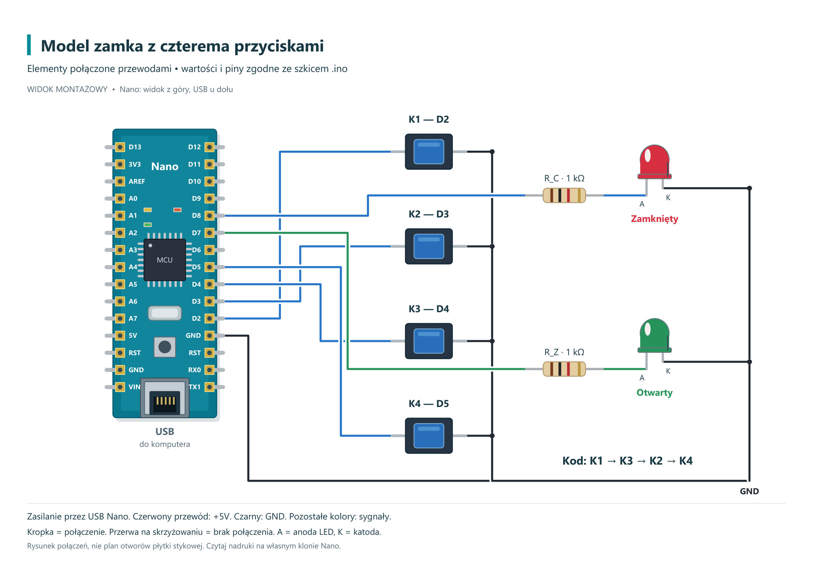

# Model zamka z czterema przyciskami

**Poziom:** średni · **Czas orientacyjny:** 45–75 min · **Płytka:** klasyczne Nano / zgodny klon z logiką 5 V.

Wprowadź kod 1–3–2–4. Zielona LED oznacza otwarcie, czerwona zamknięcie. Zły klawisz zeruje próbę, a otwarcie trwa co najmniej 5 sekund. Monitor portu szeregowego pokazuje naciskane przyciski, wpisaną sekwencję i bieżący stan zamka.

## Elementy z zestawu

- Nano 5 V, USB, płytka stykowa i przewody
- przyciski chwilowe — 4 szt.
- LED czerwona i zielona — po 1 szt.
- rezystory 1 kΩ — 2 szt.

Projekty wykonujesz kolejno, wykorzystując ponownie tę samą płytkę i części. Przewód USB oraz komputer to stanowisko do zasilania i wgrywania kodu.

## Schemat i połączenia

[Otwórz schemat w pełnej rozdzielczości](schemat_montazowy.png).



Nano pokazano z góry, z USB u dołu i kolejnością pinów klasycznego Nano. Połączenia wykonuj według oznaczeń na własnej płytce. To widok elementów i przewodów; grupy otworów płytki stykowej trzeba dobrać samodzielnie.

**Czerwony przewód: +5V. Czarny: GND. Pozostałe kolory: sygnały.** Kropka oznacza połączenie, a przerwa przy skrzyżowaniu — brak połączenia. A to anoda LED, K — katoda. Każda LED ma własny rezystor 1 kΩ.

| Od | Do | Uwagi |
|---|---|---|
| Nano D2 | Klawisz K1 → GND | Numer 1 |
| Nano D3 | Klawisz K2 → GND | Numer 2 |
| Nano D4 | Klawisz K3 → GND | Numer 3 |
| Nano D5 | Klawisz K4 → GND | Numer 4 |
| Nano D7 | Rezystor 1 kΩ → anoda zielonej LED | Otwarty |
| Katoda zielonej LED | Nano GND | Masa |
| Nano D8 | Rezystor 1 kΩ → anoda czerwonej LED | Zamknięty |
| Katoda czerwonej LED | Nano GND | Masa |

## Montaż i uruchomienie

Przepinaj elementy przy odłączonym USB. Obie nóżki LED muszą należeć do różnych węzłów; każda LED ma własny rezystor. Sprawdź, czy szyny płytki stykowej są ciągłe, i w razie potrzeby połącz ich segmenty.

1. Ustaw cztery przyciski w szeregu i opisz je K1–K4. Każdy łączy swój pin z GND.
2. Podłącz LED z osobnymi rezystorami. Nie łącz przycisków z +5V.
3. Wgraj [zamek_szyfrowy.ino](zamek_szyfrowy.ino) z dołączonym `Przycisk.h`. W Arduino IDE otwórz **Monitor portu szeregowego / Serial Monitor** i ustaw **9600 baud**.
4. Naciskaj kolejno K1, K3, K2, K4, puszczając każdy przed następnym.

Otwórz **zamek_szyfrowy.ino** w Arduino IDE. Pozostaw `Przycisk.h` w tym samym folderze. Nie instalujesz dodatkowych bibliotek. Wybór płytki i portu opisano w [instrukcji uruchomienia](../../README.md#uruchomienie).

## Co pokazuje Monitor portu szeregowego

Naciskaj przyciski układu — raport pojawia się automatycznie. Program rozróżnia:

- `Nacisnieto K1 (D2).` i `Zwolniono K1.` — zdarzenie dla konkretnego przycisku. K1–K4 odpowiadają pinom D2–D5.
- `Trzymane: [K1 K3]` — przyciski aktualnie przytrzymywane, po odfiltrowaniu drgań styków. `Trzymane: [brak]` oznacza, że wszystkie są puszczone.
- `Wpisano: [1 3 _ _]` — kolejność naciśnięć w bieżącej próbie. `_` oznacza wolne miejsce. Puszczenie klawisza nie usuwa go z tej sekwencji.
- `Stan: ZAMKNIETY`, `OTWARTY` lub `BLAD` — bieżący stan modelu zamka.

Przykład po naciśnięciu K1, puszczeniu go i naciśnięciu K3:

```text
Nacisnieto K1 (D2).
Trzymane: [K1]
Stan: ZAMKNIETY | Wpisano: [1 _ _ _]
Zwolniono K1.
Trzymane: [brak]
Nacisnieto K3 (D4).
Trzymane: [K3]
Stan: ZAMKNIETY | Wpisano: [1 3 _ _]
```

Po pełnym poprawnym kodzie pojawia się `Stan: OTWARTY | Wpisano: [1 3 2 4]`. Sekwencja pozostaje widoczna do ponownego zamknięcia.

Przy błędnym klawiszu program pokazuje rzeczywiście wpisaną, nieudaną próbę, po czym ją kasuje i wypisuje `Stan: BLAD | Wpisano: [_ _ _ _]`. Jednoczesne przyciski także odrzucają próbę. Przerwa co najmniej 10 sekund zeruje częściowy kod; komunikat informuje o rozpoczęciu od początku. Limit dotyczy odstępu między kolejnymi naciśnięciami podczas wpisywania kodu.

Naciśnięcia podczas otwarcia lub sygnalizowania błędu nadal są pokazywane, z informacją, że pominięto je przy wpisywaniu kodu. Raporty pojawiają się przy zdarzeniach i zmianach stanu; samo przytrzymanie przycisku nie powoduje ciągłego wypisywania.

## Sprawdzenie na stanowisku

Poniższe testy należy wykonać na złożonym układzie. Oczekiwane wyniki nie oznaczają, że zestaw ze zdjęcia został fizycznie przetestowany.

| Próba | Oczekiwany wynik |
|---|---|
| Kod 1–3–2–4, przerwy poniżej 10 s | Zielona LED włącza się, czerwona gaśnie. |
| Błędny klawisz | Czerwona LED miga przez około 1 s; próbę zaczynasz od początku. |
| Przerwa co najmniej 10 s w połowie kodu | Postęp zostaje wyzerowany. |
| Dwa klawisze przytrzymane jednocześnie | Próba jest odrzucana. |
| Po poprawnym kodzie | Po co najmniej 5 s i puszczeniu wszystkich klawiszy wraca stan zamknięty. |
| Naciśnij K1, puść go, następnie naciśnij K3 | Monitor pokazuje kolejno `[1 _ _ _]` i `[1 3 _ _]`; puszczenie K1 nie kasuje sekwencji. |
| Przytrzymaj jeden klawisz | Jeden komunikat naciśnięcia; lista `Trzymane` pokazuje ten klawisz do puszczenia. |

## Co wyjaśnić uczniom

Tablica z kodem, liczenie postępu, filtrowanie klawiszy, odmierzanie czasu i raportowanie zdarzeń przez `Serial`. Wpisana sekwencja jest osobną informacją od aktualnie trzymanych przycisków.

To model logiczny: stan otwarcia pokazuje LED. Nie ma mechanizmu ryglującego. Każdy klawisz jest osobnym wejściem INPUT_PULLUP; nie budujemy matrycy przycisków. Po błędzie trzeba puścić klawisze. Kod nie jest rozwiązaniem zabezpieczającym dostęp.

## Zadania dodatkowe

- Zmień tablicę SECRET i zapisz nowy kod w instrukcji.
- Dodaj licznik błędnych prób, pokazywany w Serial.

## Gdy coś nie działa

- Sprawdź zgodność modelu i logiki 5 V oraz wybraną płytkę i port w IDE.
- Sprawdź wspólną masę i rzeczywiste grupy po pięć otworów w breadboardzie.
- Dla przycisku użyj dwóch styków, które łączą się dopiero po wciśnięciu; w zestawie etykieta wskazuje model dwunóżkowy.
- Sprawdź polaryzację LED, wartość rezystora i zgodność numeru pinu z kodem.

## Weryfikacja i źródła

Kod sprawdzono przez kompilację dla ATmega328P 16 MHz z Arduino AVR Boards 1.8.8 oraz testy logiki z symulowanymi wejściami. Nie wykonano prób na fizycznym zestawie. Testy stanowiskowe powyżej wykonaj po złożeniu układu.

[Arduino INPUT_PULLUP](https://docs.arduino.cc/built-in-examples/digital/InputPullupSerial/) · [Arduino millis()](https://docs.arduino.cc/language-reference/en/functions/time/millis/)

[← Wszystkie projekty](../../README.md)
